<a name="readme-top"></a>

<p align="center">
  <picture>
    <source media="(prefers-color-scheme: dark)" srcset="./packages/ui/assets/brand/anhourmail-logo-dark.svg">
    
  </picture>
</p>

<p align="center">
  
</p>

<h1 align="center">AnhourMail</h1>

<p align="center">
  <b>Private, fast hosted email with a modern open-source webmail.</b><br>
  Your own domain, aliases and masked aliases, shared mailboxes, and a JMAP webmail that loads instantly.<br>
  No tracking, no ads, open source.
</p>

<p align="center">
  <a href="./LICENSE"></a>
  <a href="#license"></a>
  <a href="#status"></a>
  
  
  
  <a href="#why-anhourmail"></a>
</p>

<p align="center">
  <a href="https://github.com/anhourtec/anhourmail/stargazers"></a>
  <a href="https://github.com/anhourtec/anhourmail/graphs/contributors"></a>
  <a href="https://anhourmail.com"></a>
</p>

<p align="center">
  Built and maintained by <a href="https://github.com/anhourtec"><b>Anhourtec</b></a> ·
  <a href="https://anhourmail.com"><b>anhourmail.com</b></a> ·
  <a href="https://anhourmail.com/docs"><b>Docs</b></a> ·
  <a href="https://anhourmail.com/changelog"><b>Changelog</b></a> ·
  <a href="https://anhourmail.com/docs/self-hosting"><b>Self-hosting</b></a>
</p>

<p align="center">
  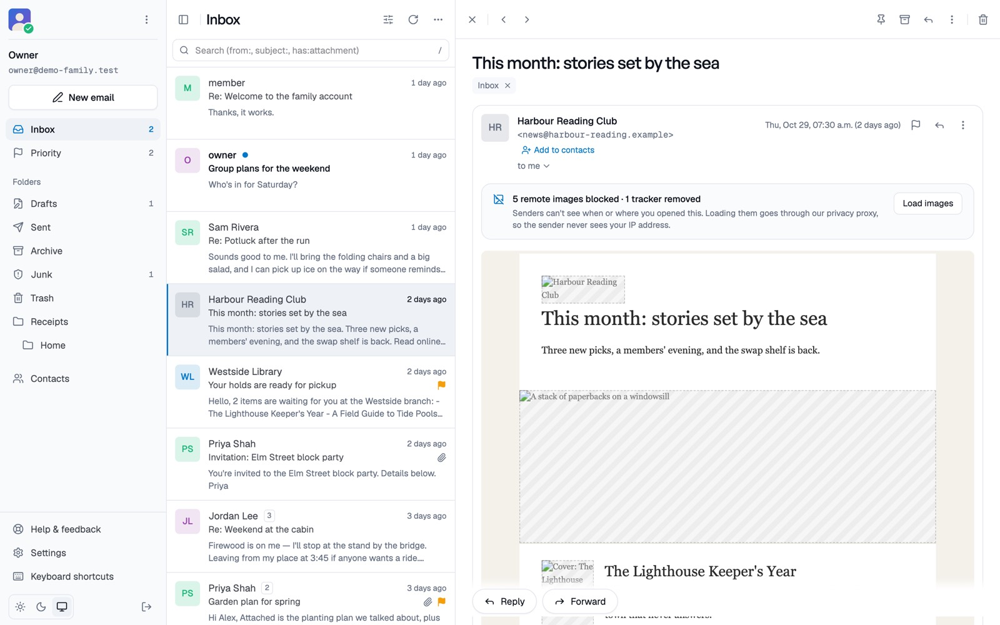
  <br>
  <sub>The webmail reading an HTML newsletter: remote images stay blocked until you choose to load them, and trackers
  are removed. Screenshots show made-up demo data from the local development stack.</sub>
</p>

> [!NOTE]
> **In development, not open for sign-ups yet.** A pre-staging server has run since 2026-10-23 with real DNS,
> certificates and external mail. Follow along in the [changelog](https://anhourmail.com/changelog) and the
> [roadmap](./docs/internal/09-roadmap.md); see [Status](#status).

<p align="center">
  <a href="#start-here">Start here</a> ·
  <a href="#why-anhourmail">Why AnhourMail</a> ·
  <a href="#features">Features</a> ·
  <a href="#what-works-today">What works today</a> ·
  <a href="#status">Status</a> ·
  <a href="#how-it-works">How it works</a> ·
  <a href="#quick-start-local-development">Quick start</a> ·
  <a href="#project-layout">Project layout</a> ·
  <a href="#questions-people-ask">Questions people ask</a> ·
  <a href="#contributing">Contributing</a> ·
  <a href="#license">License</a>
</p>

<table>
  <tr>
    <td width="25%" valign="top">
      <h3>🔒 Private by default</h3>
      No tracking pixels and no third-party analytics anywhere. Remote images stay blocked until you load them, then
      come through our privacy proxy. HTML mail is shown in a sandboxed frame.
    </td>
    <td width="25%" valign="top">
      <h3>⚡ Fast JMAP webmail</h3>
      The webmail talks JMAP through a same-origin proxy, syncs incrementally and renders long lists virtually. No
      IMAP in the browser path.
    </td>
    <td width="25%" valign="top">
      <h3>🌐 Your domain, your addresses</h3>
      Guided DNS setup with live checks for every record, catch-all, aliases and masked aliases you can switch off at
      any time.
    </td>
    <td width="25%" valign="top">
      <h3>👪 Families and small teams</h3>
      Several people in one account with roles, shared mailboxes such as <code>support@</code>, and delegation: read
      and manage, send as or send on behalf.
    </td>
  </tr>
</table>

## Start here

| You want to                     | Go to                                                                                                |
| ------------------------------- | ---------------------------------------------------------------------------------------------------- |
| **Know if you can sign up yet** | [Status](#status): in development, not open for sign-ups yet.                                        |
| **See what works today**        | [What works today](#what-works-today) and the [screenshots](#features).                              |
| **Run it on your machine**      | [Quick start](#quick-start-local-development): Node 22 and Docker; no mail ever leaves your machine. |
| **Run your own instance**       | The [self-hosting guide](https://anhourmail.com/docs/self-hosting).                                  |
| **Understand how it's built**   | [How it works](#how-it-works) and the [architecture notes](./docs/internal/01-architecture.md).      |
| **Help build it**               | [Contributing](./CONTRIBUTING.md) and the [roadmap](./docs/internal/09-roadmap.md).                  |
| **Report a security problem**   | Privately, to **security@anhourtec.com** ([SECURITY.md](./SECURITY.md)). Never in a public issue.    |

## Why AnhourMail

- **Webmail that is actually fast.** It talks [JMAP](https://jmap.io) to the mail server through a same-origin
  proxy, syncs incrementally and renders long lists virtually. No IMAP in the browser path.
- **Private by default.** No tracking pixels and no third-party analytics anywhere. Remote images stay blocked until
  you choose to load them, and then they come through our privacy proxy, so senders never see your IP address. HTML
  mail is shown in a sandboxed frame.
- **Your domain, your addresses.** Guided DNS setup with live checks for every record, catch-all, aliases and masked
  (random) aliases you can switch off at any time.
- **Built for families and small teams.** Several people in one account with roles, shared mailboxes such as
  `support@`, and delegation: give someone read and manage, send as or send on behalf of a mailbox.
- **Standard protocols.** IMAP, SMTP and JMAP for any mail app, with app passwords and two-factor sign-in.
- **Leave whenever you want.** Export everything (mail and contacts) and delete your account at any time.
- **Open source.** The apps are AGPL-3.0, the reusable libraries MIT. The mail server is
  [Stalwart](https://github.com/stalwartlabs/stalwart), run unmodified.

## Features

<table>
  <tr>
    <td width="50%" valign="top">
      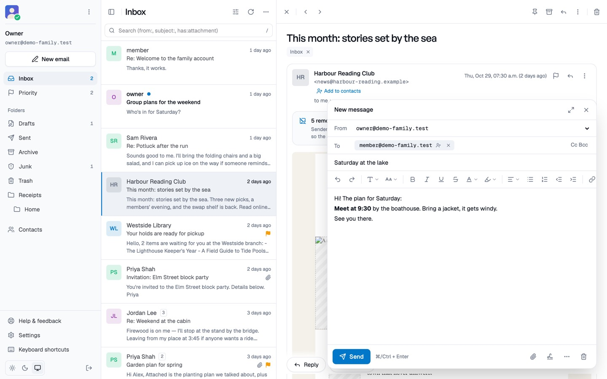
      <br><sub>Webmail · New message</sub>
      <h3>Write with rich text</h3>
      <p>Fonts, colours, lists and links, sent with a plain-text copy for every mail app. Drafts keep your work,
      undo send gives you a moment to change your mind, and named signatures are a click away.</p>
    </td>
    <td width="50%" valign="top">
      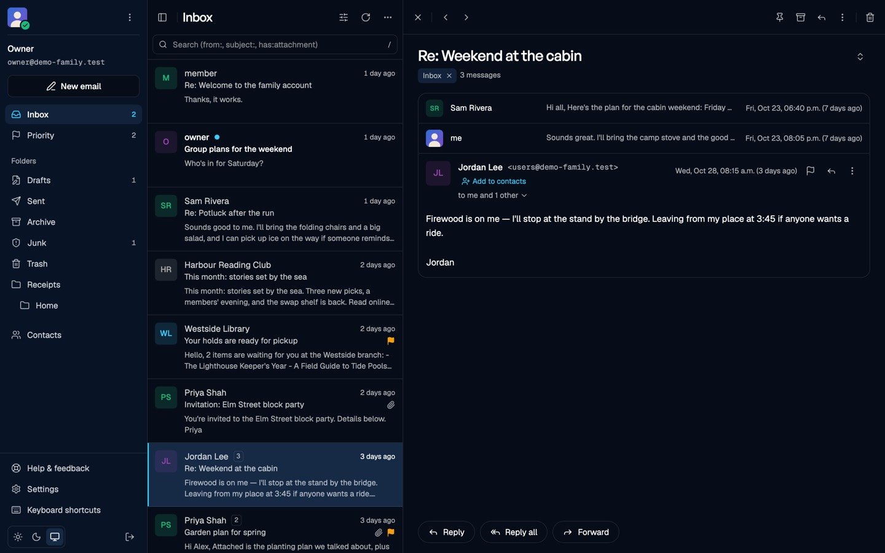
      <br><sub>Webmail · Conversation, dark theme</sub>
      <h3>Folders, threads and search</h3>
      <p>Conversations stay together. Archive, junk, move, pin and search from the keyboard or the toolbar, and keep
      several mailboxes signed in at once. Light, dark or your system's theme.</p>
    </td>
  </tr>
  <tr>
    <td width="50%" valign="top">
      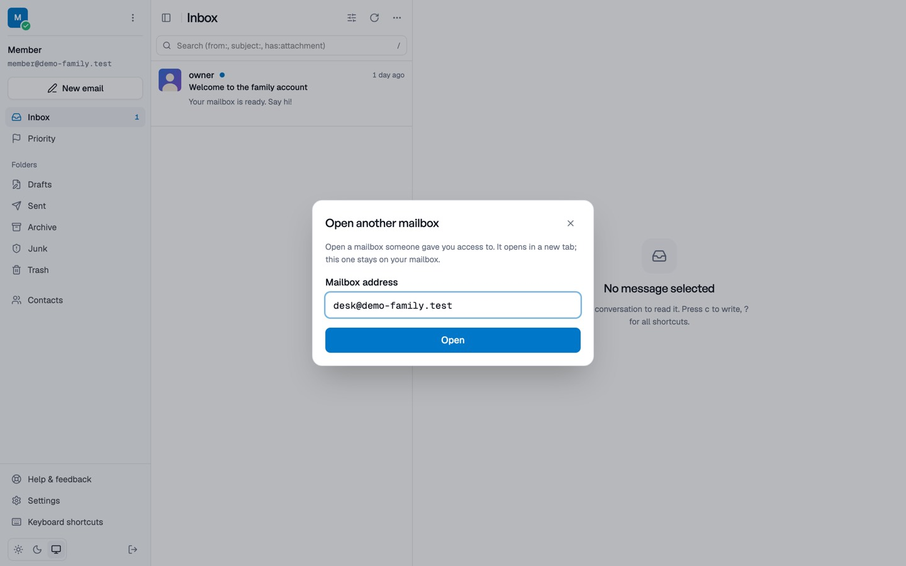
      <br><sub>Webmail · Open another mailbox</sub>
      <h3>Shared mailboxes in a tab of their own</h3>
      <p>Open a mailbox someone gave you access to by its address. It opens in a new tab, your own mailbox stays
      where it is, and the shared address can be chosen as From.</p>
    </td>
    <td width="50%" valign="top">
      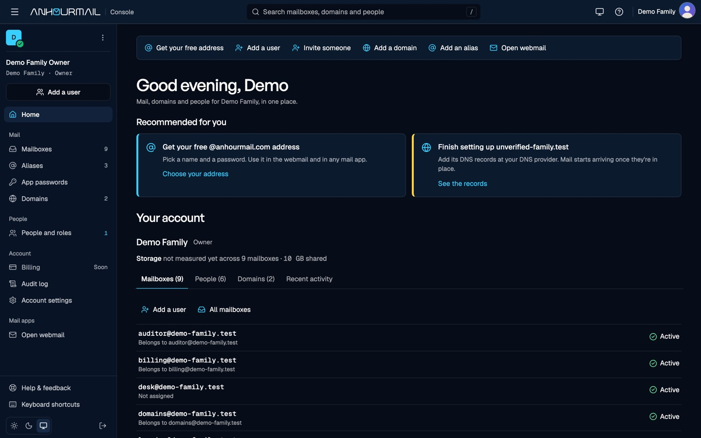
      <br><sub>Console · Home, dark theme</sub>
      <h3>One console for mail, domains and people</h3>
      <p>Quick actions, recommended next steps and the whole account at a glance: mailboxes, people, domains and
      recent activity.</p>
    </td>
  </tr>
  <tr>
    <td width="50%" valign="top">
      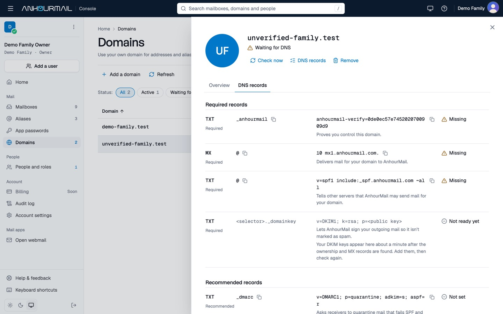
      <br><sub>Console · Domains · DNS records</sub>
      <h3>Your domain, checked live</h3>
      <p>Every record you need, with a copy button and a live check, including DKIM (published as TXT keys), SPF and
      DMARC. Each one turns green as your DNS provider picks it up.</p>
    </td>
    <td width="50%" valign="top">
      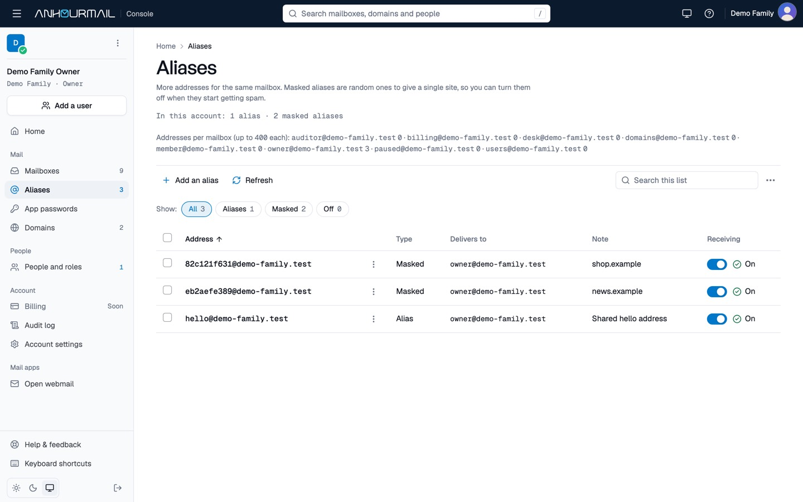
      <br><sub>Console · Aliases</sub>
      <h3>Aliases and masked aliases</h3>
      <p>More addresses for the same mailbox. Give a site a random masked alias, and switch it off the day it starts
      getting spam. Mail you send from a masked alias carries no name, and images from your safe senders load by themselves.</p>
    </td>
  </tr>
  <tr>
    <td width="50%" valign="top">
      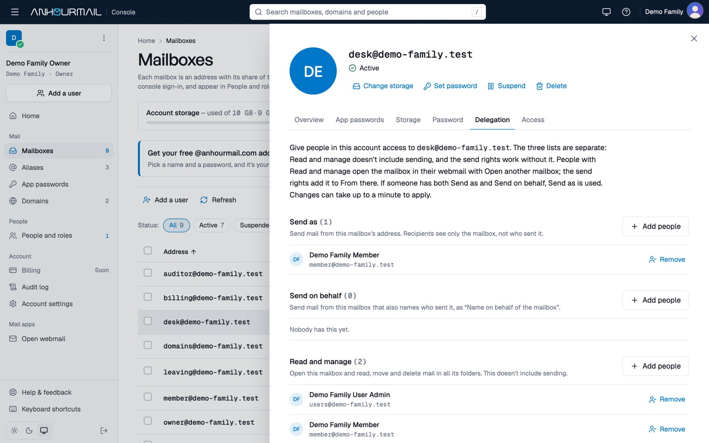
      <br><sub>Console · Mailboxes · Delegation</sub>
      <h3>Delegation you can read at a glance</h3>
      <p>Give people <b>Read and manage</b>, <b>Send as</b> or <b>Send on behalf</b> on a mailbox, as three separate
      lists. Convert a mailbox to a shared one and back.</p>
    </td>
    <td width="50%" valign="top">
      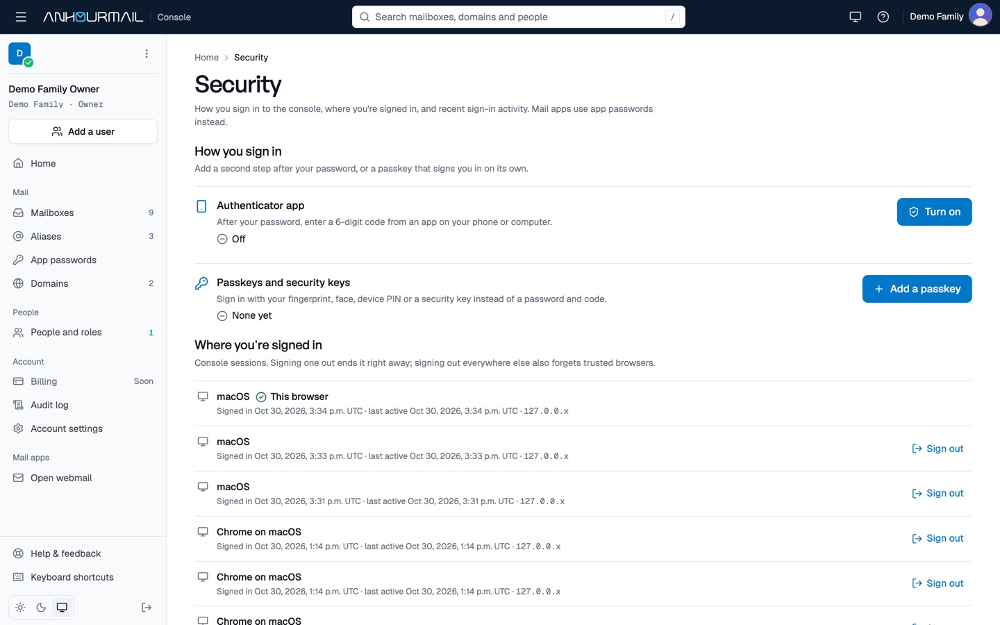
      <br><sub>Console · Security</sub>
      <h3>Two-factor sign-in and passkeys</h3>
      <p>Your password first, then a passkey, an authenticator app or a recovery code as the second step, with sessions and recent activity in one place. Owners can
      require a second factor.</p>
    </td>
  </tr>
  <tr>
    <td width="50%" valign="top">
      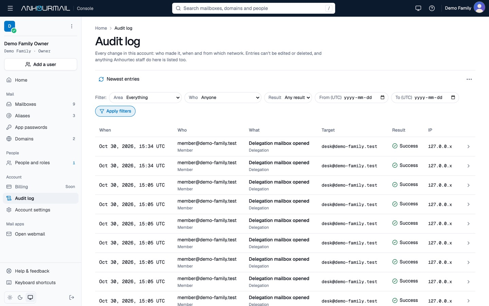
      <br><sub>Console · Audit log</sub>
      <h3>An audit log you can trust</h3>
      <p>Every change, who made it and when, append-only and tamper-evident. Anything Anhourtec staff do in your
      account is listed too.</p>
    </td>
    <td width="50%" valign="top">
      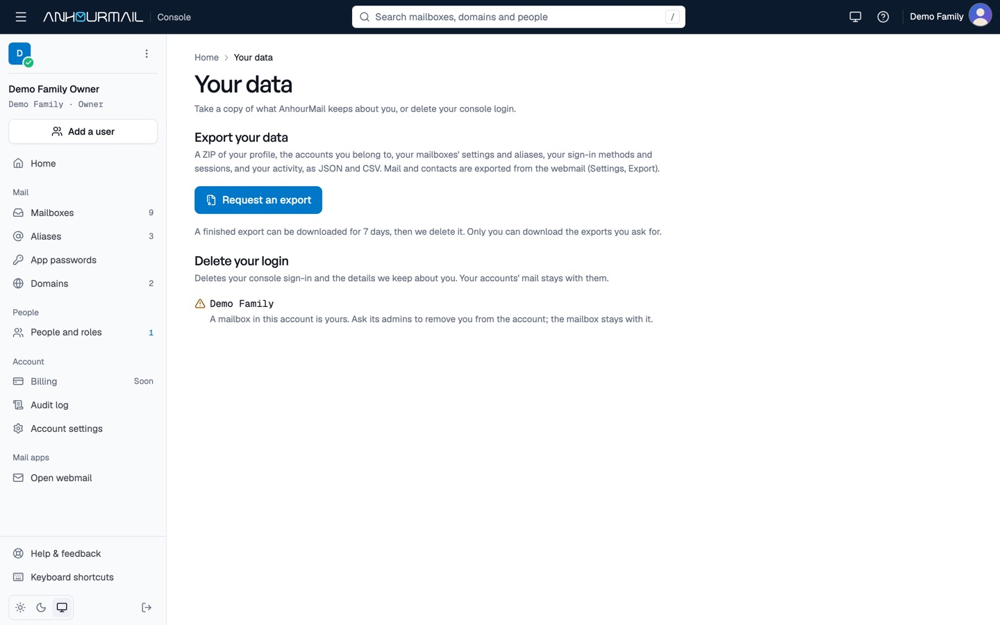
      <br><sub>Console · Your data</sub>
      <h3>Take your data, or leave</h3>
      <p>Export your mail and contacts, and delete your account whenever you like, with a 14-day grace period.</p>
    </td>
  </tr>
</table>

## Everything in the box

<table>
  <tr>
    <td width="33%" valign="top">
      <h3>📬 Mail and webmail</h3>
      <ul>
        <li>IMAP, SMTP and JMAP</li>
        <li>JMAP webmail: incremental sync, virtual lists</li>
        <li>Folders and threads, a safe reader</li>
        <li>Rich text, sent with a plain-text copy</li>
        <li>Drafts and undo send</li>
        <li>Archive, junk, move, pin, search</li>
        <li>Several mailboxes in one session</li>
        <li>Named signatures, automatic replies</li>
        <li>Confirmed forwarding, blocked senders</li>
        <li>Contacts that sync over CardDAV</li>
      </ul>
    </td>
    <td width="33%" valign="top">
      <h3>🌐 Domains and addresses</h3>
      <ul>
        <li>One free <code>you@anhourmail.com</code> address</li>
        <li>Reserved system and staff names; names never reissued</li>
        <li>Custom domains with guided DNS and live checks</li>
        <li>DKIM as TXT keys, SPF and DMARC</li>
        <li>Catch-all on custom domains</li>
        <li>Aliases and masked aliases, up to 400 per mailbox on paid plans</li>
        <li>"Add a user" in four steps</li>
        <li>Storage, suspend, resume, 30-day restore</li>
        <li>App passwords scoped to IMAP, SMTP, contacts or mail over HTTPS</li>
      </ul>
    </td>
    <td width="33%" valign="top">
      <h3>👪 People, security and privacy</h3>
      <ul>
        <li>Invites, roles, profile details and photos</li>
        <li>Shared mailboxes and delegation</li>
        <li>Leavers' mail kept as a shared mailbox</li>
        <li>Authenticator app, recovery codes, passkeys</li>
        <li>Sessions and recent activity</li>
        <li>No tracking pixels, no third-party analytics</li>
        <li>Remote images blocked, then proxied</li>
        <li>Tamper-evident audit log</li>
        <li>Read-only, explained support access</li>
        <li>Export, and deletion with a 14-day grace period</li>
      </ul>
    </td>
  </tr>
</table>

## What works today

Everything below runs in local development and on our pre-staging server. It is not open to the public yet.

| Area                 | What you can do                                                                                                                                                                                                                                                                                |
| -------------------- | ---------------------------------------------------------------------------------------------------------------------------------------------------------------------------------------------------------------------------------------------------------------------------------------------- |
| **Free address**     | Claim one free `you@anhourmail.com` address after confirming your email. Names that would pass for system or staff addresses are reserved, and a name is never handed out again.                                                                                                               |
| **Custom domains**   | Add a domain, follow the guided DNS steps (DKIM published as TXT keys) and watch each record turn green. Catch-all on custom domains.                                                                                                                                                          |
| **Mailboxes**        | "Add a user" in four steps (mailbox, sign-in and role together, with a password change at first sign-in); passwords set or generated, owner resets with a step-up, storage, suspend, resume, and delete with a 30-day restore window.                                                          |
| **Aliases**          | Aliases and masked aliases, up to 400 per mailbox on paid plans, each switchable on and off.                                                                                                                                                                                                   |
| **People and roles** | Invites, roles, profile details and photos. Removing someone keeps their mail as a shared mailbox and turns their sign-in off at once.                                                                                                                                                         |
| **Delegation**       | Give people **Read and manage**, **Send as** or **Send on behalf** on a mailbox. Convert a mailbox to a shared mailbox and back. In the webmail, shared mailboxes open by address in a tab of their own (Open another mailbox) and can be chosen as From.                                      |
| **Sign-in security** | Password first, then a second step with a passkey, an authenticator app or a recovery code; owners can require a second factor; a Security page with sessions and recent activity.                                                                                                             |
| **Mail apps**        | App passwords scoped to IMAP, SMTP, contacts or mail over HTTPS, shown once.                                                                                                                                                                                                                   |
| **Webmail**          | Folders and threads, a safe reader, rich-text writing (sent with a plain-text copy), drafts and undo send, archive, junk, move, pin, search, several mailboxes in one session, contacts that sync over CardDAV, named signatures, automatic replies, confirmed forwarding and blocked senders. |
| **Your data**        | Export your mail and contacts; delete your account with a 14-day grace period.                                                                                                                                                                                                                 |
| **Accountability**   | An append-only, tamper-evident audit log for every change. When Anhourtec support needs to look at your console, it is read-only, short, explained and shown in your audit log.                                                                                                                |

## Status

> [!IMPORTANT]
> **In development, not open for sign-ups yet.** A pre-staging server has run since 2026-10-23 with real DNS,
> certificates and external mail. Billing, importing mail from another provider, abuse controls and monitoring are
> still to come (see the phases below). Follow along in the
> [roadmap](./docs/internal/09-roadmap.md) and the [changelog](https://anhourmail.com/changelog).

| Phase | What                                                                | State                               |
| ----- | ------------------------------------------------------------------- | ----------------------------------- |
| 0     | Research, docs, scaffold                                            | ✅ done                             |
| 1     | Dev stack and mail-server prototypes                                | ✅ done                             |
| 2     | Marketing site and public docs                                      | ✅ built (legal review open)        |
| 3     | Control plane: accounts, domains, mailboxes, aliases, people, audit | ✅ built                            |
| 4     | Webmail on JMAP                                                     | ✅ built (push sync and rules next) |
| —     | Pre-staging on one server                                           | 🟢 running                          |
| 5     | Billing, and importing mail and contacts from another provider      | ⏳ next                             |
| 6     | Abuse controls, monitoring, backups                                 | ⏳ planned                          |
| 7–9   | Dogfooding, closed beta, public launch                              | ⏳ planned                          |

Plans, prices and limits are defined once in [`packages/shared`](./packages/shared) and rendered into the app, the
marketing site and the docs, so they never disagree.

## How it works

```
            browser
               │  HTTPS
     ┌─────────┴───────────────────────────────┐
     │ NGINX (TLS for the web hosts)           │
     └──┬──────────────┬──────────────────┬────┘
        │              │                  │
  anhourmail.com   app.anhourmail.com   mail.anhourmail.com
  apps/site        apps/web (console)   apps/web (webmail, same app,
  site + /docs                          its own origin)
                       │                  │  same-origin JMAP proxy
                       │                  ▼
                       │   packages/jmap-client ──► Stalwart JMAP
                       │
                       ├── packages/stalwart-client ──► Stalwart management (internal only)
                       ├── Postgres (control plane only, never mail content)
                       └── Redis (sessions, queues, rate limits)

  apps/worker: provisioning jobs, DNS checks, quota sync, reconciler, exports
  Stalwart: SMTP 25/465/587, IMAP 993, POP3 995, run unmodified
```

1. **Stalwart handles mail.** It is run unmodified and driven only through its management API.
2. **Our control plane handles everything else.** Sign-up, people, plans, domains, mailboxes, aliases, limits,
   abuse controls and the audit log live in Postgres. Changes to the mail server are queued jobs that a worker
   applies and checks.
3. **The webmail never hands the browser a mail-server token.** It talks to a same-origin proxy that adds the
   person's token on the server and only lets through what the webmail needs.

More detail: [architecture](./docs/internal/01-architecture.md) · [security](./docs/internal/07-security.md) ·
[decisions (ADRs)](./docs/internal/adr).

## Quick start (local development)

You need Node.js 22, npm 10 and Docker. Nothing in the dev stack can send mail off your machine: every outbound
message lands in Mailpit, and the mail server's network has no internet route.

```bash
cp .env.example .env
npm ci
npm run dev                 # starts the compose services if needed, then every app
npm run db:seed -- --demo   # demo accounts; writes credentials.md (gitignored, local only)
```

| What                | URL                                                               |
| ------------------- | ----------------------------------------------------------------- |
| Marketing site      | http://localhost:43100                                            |
| Docs                | http://localhost:43100/docs                                       |
| Changelog / credits | http://localhost:43100/changelog, /credits                        |
| Console             | http://localhost:43200                                            |
| Webmail             | http://localhost:43300 (same app as the console, on its own port) |
| Mailpit UI          | http://localhost:43026                                            |
| Stalwart admin UI   | http://localhost:43080/admin                                      |
| Postgres / Redis    | 127.0.0.1:43432 / 127.0.0.1:43379                                 |

All ports are bound to `127.0.0.1` and can be changed in `.env`; `npm run ports:check` reports clashes.

| Command                                            | What it does                                                          |
| -------------------------------------------------- | --------------------------------------------------------------------- |
| `npm run dev:reset`                                | Wipe the local volumes, migrate and re-seed                           |
| `npm run check`                                    | Lint, format, types and the repository checks                         |
| `npm test` · `test:int` · `test:rbac` · `test:e2e` | Unit · integration (real stack) · every route as every role · browser |
| `npm run stack:verify`                             | Prove the mail stack: delivery, sender rules, no egress               |
| `npm run ci:local`                                 | The whole CI pipeline on a clean copy of your commits                 |

> [!TIP]
> To run your own instance, follow the [self-hosting guide](https://anhourmail.com/docs/self-hosting).

## Project layout

| Path                       | What it is                                                           | Licence       |
| -------------------------- | -------------------------------------------------------------------- | ------------- |
| `apps/web`                 | Console and webmail (Next.js), API routes, JMAP proxy                | AGPL-3.0-only |
| `apps/site`                | Marketing site, public docs (`/docs`), changelog, credits            | AGPL-3.0-only |
| `apps/worker`              | Jobs and scheduler: provisioning, DNS checks, reconciler, exports    | AGPL-3.0-only |
| `packages/core`            | Domain rules and services, no database or SDK imports                | AGPL-3.0-only |
| `packages/adapters`        | Postgres and in-memory adapters, contract tests                      | AGPL-3.0-only |
| `packages/shared`          | Plans, limits, hostnames, DNS templates, roles (one source of truth) | AGPL-3.0-only |
| `packages/ui`              | Design tokens, fonts, skeletons, brand assets                        | AGPL-3.0-only |
| `packages/jmap-client`     | Small typed JMAP client                                              | MIT           |
| `packages/stalwart-client` | Client for Stalwart's management API                                 | MIT           |
| `packages/server`          | Logger, health probes, Redis helpers                                 | MIT           |
| `packages/config`          | Shared TypeScript config                                             | MIT           |
| `infra/`                   | Stalwart and Postgres dev configuration                              | AGPL-3.0-only |
| `docs/public`              | User guides published at anhourmail.com/docs                         | —             |
| `docs/internal`            | Architecture, ADRs, research, runbooks                               | —             |
| `docs/images/readme`       | Screenshots used in this README (demo data only)                     | —             |

## Questions people ask

<details open>
<summary><b>Can I sign up?</b></summary>

Not yet. AnhourMail is in development and runs on a pre-staging server. Watch or star the repo, or follow the
[changelog](https://anhourmail.com/changelog), to hear when sign-ups open.

</details>

<details>
<summary><b>Is there a free plan?</b></summary>

Yes: one free `you@anhourmail.com` address. Custom domains, more people and more storage come with the paid plans.
Plans and prices are on [anhourmail.com](https://anhourmail.com).

</details>

<details>
<summary><b>Does it work with my mail app?</b></summary>

Any app that speaks IMAP and SMTP works, on phones and computers. Contacts sync over CardDAV. Mail apps sign in
with app passwords, so your main password and two-factor sign-in stay with the console and webmail.

</details>

<details>
<summary><b>Can I use my own domain?</b></summary>

Yes, on the paid plans. The console shows every DNS record to add and checks each one live, including DKIM, SPF and
DMARC.

</details>

<details>
<summary><b>Can several people share a mailbox, like <code>support@</code>?</b></summary>

Yes. A shared mailbox has no sign-in of its own; admins give people Read and manage, Send as or Send on behalf.
Mail sent from it keeps its copy in that mailbox's Sent folder, and every grant and delegated send is in the audit
log.

</details>

<details>
<summary><b>What happens to someone's mail when they leave?</b></summary>

Removing a person keeps their mailbox and mail as a shared mailbox and turns their sign-in off straight away. You
can then give someone else access, make it another person's mailbox, or delete it.

</details>

<details>
<summary><b>Do you read my mail?</b></summary>

No. Mail content never enters our database, logs, analytics or error reports. When Anhourtec support helps you,
they see your console read-only, for a short time, with a reason your owners are told about, and never your mail.

</details>

<details>
<summary><b>Why are images in my mail blocked?</b></summary>

Remote images can tell a sender when and where you opened a message. They stay blocked until you load them, and
then they come through our privacy proxy, so the sender never sees your IP address. You can load them just once or
always for a sender we can verify.

</details>

<details>
<summary><b>Can I take my mail with me?</b></summary>

Yes. Export your mail and contacts at any time, and delete your account whenever you like. Importing from another
provider is coming with billing (Phase 5).

</details>

<details>
<summary><b>Can I run it myself?</b></summary>

Yes. The code is open and the [self-hosting guide](https://anhourmail.com/docs/self-hosting) walks through it. Forks
must use their own name and logo (see [Trademarks](#trademarks)).

</details>

## Built with

AnhourMail stands on the work of these projects. Thank you.

- [Stalwart](https://github.com/stalwartlabs/stalwart): the mail server (AGPL-3.0, Stalwart Labs), run unmodified
- [Next.js](https://nextjs.org) and [React](https://react.dev)
- [shadcn/ui](https://ui.shadcn.com), [Tailwind CSS](https://tailwindcss.com) and [Lucide](https://lucide.dev)
- [PostgreSQL](https://www.postgresql.org) and [Redis](https://redis.io)
- [Drizzle ORM](https://orm.drizzle.team) and [Better Auth](https://www.better-auth.com)
- [Fumadocs](https://fumadocs.dev) for the docs
- [Playwright](https://playwright.dev) and [Vitest](https://vitest.dev) for testing
- [Mailpit](https://mailpit.axllent.org) for safe local mail

The full list of dependencies and their licences is in [THIRD_PARTY_NOTICES.md](./THIRD_PARTY_NOTICES.md) and on
[anhourmail.com/credits](https://anhourmail.com/credits). Listing a project here does not imply its endorsement of
AnhourMail.

## Contributing

Issues and pull requests are welcome. Please read the [Contributing Guide](./CONTRIBUTING.md) first. Contributors
sign our [Contributor License Agreement](./CLA.md) once, through the CLA Assistant bot on their first pull request,
and follow our [Code of Conduct](./CODE_OF_CONDUCT.md). Please never post passwords, account details, server
addresses or mail content in issues.

<a href="https://github.com/anhourtec/anhourmail/graphs/contributors">
  
</a>

## Security

> [!CAUTION]
> Please don't open public issues for security problems. Report them privately to **security@anhourtec.com**; see
> [SECURITY.md](./SECURITY.md).

## License

- **Apps** (`apps/*`) and the product packages (`core`, `adapters`, `shared`, `ui`) are licensed under the **GNU
  Affero General Public License v3.0 only** ([LICENSE](./LICENSE)).
- **Reusable libraries** (`packages/jmap-client`, `packages/stalwart-client`, `packages/server`, `packages/config`)
  are licensed under the **MIT License**; see the `LICENSE` file in each package.
- Every source file carries an SPDX header saying which licence applies. Code derived from HourMail (MIT) keeps its
  original MIT notice in those files.
- **Stalwart** is AGPL-3.0 software by Stalwart Labs. AnhourMail runs it unmodified and talks to it over its public
  APIs; its source is at [github.com/stalwartlabs/stalwart](https://github.com/stalwartlabs/stalwart). If we ever
  modify it, we will publish those changes.
- **Commercial licences:** the [CLA](./CLA.md) lets Anhourtec offer the code under commercial terms as well. That
  revenue funds development, while the public code stays AGPL.

## Trademarks

"AnhourMail" and the AnhourMail logo are trademarks of Anhourtec. The code is open; the name is not. Forks must use a
different name and logo; see [TRADEMARKS.md](./TRADEMARKS.md).

<p align="right"><a href="#readme-top">↑ Back to top</a></p>

<!-- Keywords: private email hosting, privacy email, open source webmail, JMAP webmail, custom domain email, email aliases, masked email aliases, shared mailbox, mailbox delegation, send on behalf, Stalwart mail server, self-hosted email, IMAP SMTP JMAP, family email, small team email -->
