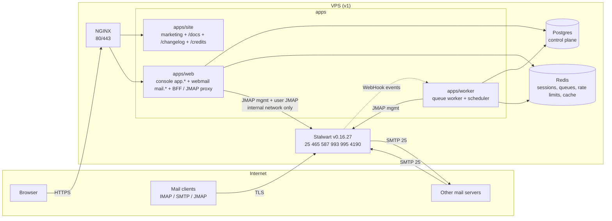

# 01 — Architecture

Last updated: 2026-10-21. Decisions: `adr/`. Code map: `codemap.md`.

## Overview



```
browser ──HTTPS──► NGINX ─┬─► apps/site  (anhourmail.com: marketing, /docs, /changelog, /credits)
                          └─► apps/web   (app.anhourmail.com console, mail.anhourmail.com webmail)
                                 │  BFF: our session ─► Stalwart token (server-side only)
                                 ├─► Postgres (control plane, never mail content)
                                 ├─► Redis
                                 └─► Stalwart /jmap  (internal network only)
apps/worker ─► Postgres, Redis, Stalwart management (provisioning jobs, DNS checks, reconciler, imports)
mail clients ─► Stalwart 465/587/993/995/4190 (TLS by Stalwart itself)    MX traffic ─► Stalwart 25
```

## Components

| Component                   | Owns                                                                                                                                                                                       | Never does                                                                                                                      |
| --------------------------- | ------------------------------------------------------------------------------------------------------------------------------------------------------------------------------------------ | ------------------------------------------------------------------------------------------------------------------------------- |
| `apps/site` (Next.js 16)    | Marketing pages, public docs at `/docs` (Fumadocs, ADR-0007), `/changelog`, `/credits`                                                                                                     | Store data or call Stalwart. "Get started" and "Sign in" link to the console (`APP_URL`); the site has no forms that post data. |
| `apps/web` (Next.js 16)     | Console (sign-up, invites, plans, billing, domains, mailboxes, aliases, audit, staff tools) and webmail UI; BFF and JMAP proxy; public API routes                                          | Expose Stalwart to the browser, or put mail content in Postgres or logs                                                         |
| `apps/worker`               | Event-driven jobs (provisioning, transactional mail, Stalwart WebHook ingestion, imports) and periodic jobs (DNS checks, quota sync, reconciler, audit-chain verify, secret re-encryption) | Run anything from a host crontab                                                                                                |
| `packages/core`             | Domain types, business rules, services, repository and port interfaces, audit module                                                                                                       | Import an ORM, driver or SDK (ADR-0008, enforced by ESLint)                                                                     |
| `packages/adapters`         | Postgres (drizzle) and in-memory implementations of every repository, plus contract tests                                                                                                  | Contain business rules                                                                                                          |
| `packages/stalwart-client`  | The only Stalwart management client (JMAP `x:*` objects)                                                                                                                                   | Touch mailbox content                                                                                                           |
| `packages/jmap-client`      | The only JMAP mail client                                                                                                                                                                  | Log or persist content                                                                                                          |
| `packages/shared`           | Public facts (hostnames, ports, plans, sending limits, DNS templates), RBAC matrix, shared zod schemas                                                                                     | Hold secrets or internal thresholds                                                                                             |
| Stalwart (unmodified, AGPL) | Mail storage, SMTP/IMAP/JMAP, spam filtering, DKIM signing, mail credentials                                                                                                               | Decide tenancy or plan limits                                                                                                   |
| Postgres                    | Control-plane data                                                                                                                                                                         | Mail content                                                                                                                    |
| Redis                       | Sessions, queues, rate limits, cache                                                                                                                                                       | Anything that can't be rebuilt, except rate-limit counters that fail closed                                                     |

## Source of truth and reconciliation

- **Postgres is the source of truth for intent:** which accounts, domains, mailboxes and aliases should exist, with which quotas and limits.
- **Customer domains:** the control plane checks DNS through the `DnsResolver` port (adapters/dns: system resolver
  in production; in development `.test` names answer as fully configured, `unverified-*` as empty). A domain turns
  `active` only when the required records pass for _its_ ownership token; then a `domain.ensure` job adds it to
  Stalwart. Removal marks it `removing` and a `domain.remove` job takes it off Stalwart (refused while accounts
  remain) before the row is deleted.
- **Stalwart is the source of truth for mail state:** messages, mail credentials, DKIM keys and their published zone (`dnsZoneFile`).
- Provisioning is a **job**, never an inline request (CLAUDE.md rule 26): write intent (`status = pending`), enqueue, the worker applies it through `stalwart-client` (idempotent upserts by natural key), then set `active` or `failed` with an error code.
- The **reconciler** (scheduler, every 15 min) compares Postgres intent with Stalwart (`x:Domain`, `x:Account` lists). It **reports** drift (audit `platform.reconciler.drift` + alert) and re-applies missing non-destructive state. It **never deletes** a Stalwart account or mail automatically. Deletions are explicit jobs with a grace period.

## Identity and auth model

Two identities, deliberately separate:

|             | Console identity                                                         | Mailbox identity                                                                                                   |
| ----------- | ------------------------------------------------------------------------ | ------------------------------------------------------------------------------------------------------------------ |
| Lives in    | Postgres via better-auth                                                 | Stalwart directory                                                                                                 |
| Who         | A person (user) with memberships in accounts and optional platform roles | One mailbox (`name@domain`)                                                                                        |
| Credentials | Email + password + optional TOTP/passkey (better-auth)                   | Mailbox password (initial, set by provisioning, hashed by Stalwart), app passwords for clients (user self-service) |
| Used by     | Console, webmail (via BFF)                                               | IMAP/SMTP/JMAP clients                                                                                             |

We **never store mailbox passwords** (rule 23). Stalwart hashes them.

### Console sign-in factors (2026-10-22; `07-security.md` "Sign-in factors")

better-auth's **two-factor** plugin (TOTP + recovery codes) and **passkey** plugin (`@better-auth/passkey`, WebAuthn via
SimpleWebAuthn), plus our own plugin `packages/adapters/src/auth/security-plugin.ts` listed last so its after-hooks
see the final answers. All in `packages/adapters/src/auth` (ADR-0008); the browser never loads an auth SDK — the sign-in
form and Security page post to `/api/auth/*` directly and do the WebAuthn ceremony with `components/security/webauthn.ts`.

- Storage: `auth_two_factor` (TOTP secret = the plugin's encryption sealed again by the key ring through a wrapped
  database adapter, `sealed-adapter.ts`, AAD = user id; recovery codes as SHA-256 hashes, `recovery-codes.ts`),
  `auth_passkey` (public keys only), trusted browsers as `trust-device-*` rows in `auth_verification`.
- Sign-in: password → (2FA on, browser not trusted) a 10-minute challenge cookie → `verify-totp` or
  `verify-backup-code` → session. A passkey is a full sign-in on its own (user verification required). Our plugin
  makes codes one-time (Redis), hashes typed recovery codes, requires a current code to turn 2FA off, refuses removals
  that break an account requirement, and reports every step for the audit log (`recordSecurityEvent`, platform scope,
  target = the person).
- `/api/auth/*` is allow-listed (`server/auth/endpoints.ts`); sessions and passkey rename/remove go through core
  services (`packages/core/src/security`) so the change and its audit row share a unit of work.
- Account requirement: `customer_account.sign_in_policy`; `getActorAndSession` computes `mustEnrol` from the strictest
  policy of the person's accounts and their factors; `authorize` then refuses everything but `self` permissions
  (`enrolment_required`, 403) and console pages redirect to `/security?setup=required`.

### How the webmail gets a Stalwart session (research: `research/stalwart.md` §6)

Built in Phase 4 slice 1 (2026-10-22; ADR-0018):

1. The webmail has its own sign-in form on `mail.anhourmail.com` (mailbox address + mailbox password). The console's
   **Open webmail** link only pre-fills the address (`/sign-in?address=…`); no console cookie or handoff code reaches
   the webmail. The webmail API (`/api/webmail/*`) is served on the webmail origin only, and the console API never is
   (`server/host-routing.ts`).
2. `POST /api/webmail/auth` runs Stalwart's **headless OAuth code flow with PKCE** (`packages/stalwart-client`
   `oauth.ts`, behind `server/adapters/stalwart-oauth.ts`, client `anhourmail-webmail`): `POST /api/auth` → client
   code → `POST /auth/token`, forwarding the trusted client IP as `X-Forwarded-For` (Stalwart `x:Http.useXForwarded`). The
   password is used once and never stored or logged. Limits: `webmailSignIn` per IP and `webmailSignInAddress` (wrong
   passwords only) per address, both fail-closed; Stalwart throttling surfaces as "busy". The control plane then checks the mailbox (`MailboxAccessGate`,
   below).
3. Access and refresh tokens are **sealed with the key ring** (`packages/server/src/keyring.ts`: AES-256-GCM, HKDF per
   purpose, key id in the ciphertext, AAD = the Redis key) in Redis under `am:wm:s:<sha256(session id)>` (7 days idle,
   30 days absolute). The browser holds only the opaque id in an HttpOnly, SameSite=Lax cookie (`__Host-am.webmail` on
   https, `am.webmail` in dev). Tokens refresh a minute before expiry (one refresh per session at a time); a refused
   grant or a second 401 ends the session. Stalwart has no revocation endpoint, so sign-out drops our copy.
4. The browser calls same-origin `/api/webmail/session` (a JMAP Session document pointing at the proxy) and
   `/api/webmail/jmap`. The proxy checks the request against an allow-list (core + mail capabilities, read/list
   methods, `Email/set` for keyword updates only; ≤ 16 calls; ≤ 256 KB; `accountId` must be the session's), attaches the Bearer token, and
   forwards through a **per-user queue with ≤ 4 in flight**, retrying `limit` errors with jittered backoff. Message
   bodies come from `/api/webmail/messages/:id`, **sanitised on the server** (`server/webmail/sanitize.ts`) and shown in
   a sandboxed `srcdoc` frame; attachments stream from `/api/webmail/download/:blobId` as `attachment`, `nosniff`.
   **The browser never sees a Stalwart token.** Webmail pages get a nonce-based CSP from `src/proxy.ts`, which
   also sends visits to the webmail app page without a session cookie straight to sign-in (presence only; the page
   and the BFF still validate the session).
   **Contacts** never pass through the proxy (it refuses the contacts capability): dedicated `/api/webmail/contacts*`
   endpoints validate a small input and build JSContact cards in the mailbox's own Stalwart address books, and the
   send path saves new recipients to "Other contacts" (05-webmail.md "Contacts"). Contacts are mail data: nothing
   about them is stored in Postgres. Phones and desktop apps sync them over CardDAV on the client host.
5. **Suspension is enforced by the BFF too.** Stalwart refuses a suspended account's existing access tokens (403) but
   still honours its refresh grant and accepts the old token again after resume (`research/stalwart.md`). So every
   sign-in and every use of a session asks the control plane (`MailboxAccessGate` in `packages/core/src/webmail`,
   Postgres lookup by address, cached ≤ 30 s): `suspended`, `deleting` or unknown mailboxes end the session, and an
   upstream 403 does too. Mailboxes that exist only in Stalwart (dev `dev.test`) can't use the webmail.
6. Back-office jobs only (support tooling, imports) use an **impersonation service account** (`user%svc`): IP-restricted, secret in the key ring, every use audited. Never for interactive webmail.

Why the host split: the origin that renders untrusted email HTML (`mail.`) is isolated from the origin that can delete accounts and change billing (`app.`). A bug in message rendering cannot read console cookies or call console APIs (ADR-0003).

## Authorization

- One permission matrix in `packages/shared/src/rbac` (the code is canonical; `roles.md` describes it). UI, API and the RBAC harness all derive from it.
- Services check **permission + ownership scope**. Out-of-scope ids → **404**, missing permission → **403**, unauthenticated → **401**.
- Enrolment gate: a person missing a sign-in factor one of their accounts requires (`UserActor.mustEnrol`) passes only
  `self` permissions; everything else is 403 `enrolment_required` (other accounts' ids are still 404).
- Staff "act as" is Global/Support Administrator only, time-limited, banner-visible, audited, and never exposes mail content.
- People and invites (`packages/core/src/people`): an invite stores only the token hash; the route emails the link
  after the unit of work commits (a failed send is reported, never rolled back: resend). Accepting runs in one unit
  of work under the account row lock: conditional `invite.accept` (single use), then the membership, and — when
  signed out — the console login (`auth_user` + credential `auth_account`, argon2id hashed before the transaction)
  for the invited address. Role and removal guard rails: `roles.md` guard rail 9.
- Audit views (`packages/core/src/audit/{service,labels}.ts`): filtered, cursor-paged reads (area, actor kind or
  person, result, UTC dates); views carry only the network part of the IP and no user agent; staff and act-as are
  always labelled "Anhourtec staff". Staff look-up of an account (`packages/core/src/platform`) is metadata only and
  writes `staff.account_viewed` into that account's chain.

## Tenancy

The Stalwart Community edition has no tenants (Enterprise-only, `research/stalwart.md` §9). Tenancy and plan limits are enforced in our control plane (ADR-0002). We push derived limits to Stalwart: `quotas.maxDiskQuota`, object-count quotas, and outbound throttles keyed by `authenticatedAs`. `StalwartManagement.ensureTenant()` is a no-op seam for a future Enterprise licence.

## Request pipeline (apps/web)

`route(handler, { limit, auth, permission })` wraps every API handler: request id → access log → rate limit (tiered, fail-closed where marked) → same-origin check for unsafe methods → actor resolution → handler → error mapping (`{ error: { code, message } }`). Handlers parse and call one service. Services enforce permission and scope and write audit entries in the same unit of work (ADR-0010).

## Health

- `GET /api/health`: liveness, touches nothing.
- `GET /api/health/ready`: Postgres (2 s), Redis (1 s) and Stalwart `/healthz/ready` (2 s). All critical; 503 if any fails.
- Payloads hold statuses and latencies only. The worker and scheduler use heartbeat-file healthchecks.

## Deploy shape

|               | v1                                                                                                                                                            | v2                                                                                  |
| ------------- | ------------------------------------------------------------------------------------------------------------------------------------------------------------- | ----------------------------------------------------------------------------------- |
| Hosts         | One VPS; provider and region are an open decision, kept in the private ops repo and never published (port 25 + rDNS criteria in `research/deliverability.md`) | Mail node(s) separate from app node                                                 |
| Mail IPs      | One dedicated mail IPv4 + IPv6 with PTR = `mx1.anhourmail.com`                                                                                                | Separate outbound IP for free accounts; second MX (`mx2`) in another data centre    |
| Stores        | Stalwart RocksDB on its own volume; Postgres 17; Redis 8                                                                                                      | Stalwart on PostgreSQL (separate cluster) or RocksDB plus S3 blobs; managed backups |
| Edge          | NGINX for 80/443 (console, webmail, site, JMAP proxy); Stalwart terminates TLS on mail ports via its own ACME                                                 | Same, behind a load balancer                                                        |
| Orchestration | Docker Compose from the **private ops repo**                                                                                                                  | Compose per node                                                                    |

**Production exposure.** Only NGINX **80/443** and Stalwart's mail ports **25, 465, 587, 993, 995, 4190** are published on public interfaces. The app, worker, Postgres, Redis and Stalwart's HTTP/JMAP/management listener are reachable only on internal Docker networks. The management API is never on a public interface; NGINX proxies only what the BFF needs, and the BFF is the only path to user JMAP.

**What lives where.** This public repo ships the **images** (`deploy/Dockerfile.*`), the dev/CI `docker-compose.yml` and a self-hosting guide (`/docs/self-hosting`). Production compose files, NGINX config, server IPs, deploy secrets and tuned abuse thresholds live in a **private ops repo** and on the server, never here (rule 44).

**Dev.** `docker-compose.yml` (profiles `dev`/`ci` only) runs Postgres, Redis, Stalwart and Mailpit. Infra containers bind `DEV_BIND_ADDRESS` (default `127.0.0.1`; a maintainer may set `0.0.0.0` in their local `.env` for LAN testing). App dev servers listen on `DEV_HOST` (default `0.0.0.0`). Ports are the 43xxx scheme in CLAUDE.md: site 43100, console 43200, webmail 43300 (all on `localhost`; the webmail port is a dev forwarder into the same `apps/web`, routed by port, plus a `/webmail` fallback on 43200 in dev only), Stalwart HTTP 43080, mail ports 43025/43465/43587/43993/43190, Mailpit 43125/43026, Postgres 43432, Redis 43379. Stalwart and Mailpit sit on an internal network with no internet route (ADR-0011, `02-mail-infrastructure.md`).

## Provisioning (implemented in Phase 1)

Desired state lives in Postgres (`customer_domain`, `mailbox`, `mail_alias`); Stalwart is brought to it by jobs,
never inline in a request (CLAUDE.md rule 26).

```
console mutation ──(same transaction)──► provisioning_job (queued)
                                              │  claimNext: FOR UPDATE SKIP LOCKED; stale "running" (10 min) reclaimed
worker (apps/worker/src/worker.ts) ───────────┘
   └─ runNextJob ─► MailServer port ─► Stalwart adapter (packages/adapters/src/stalwart) ─► JMAP x:Domain / x:Account
        success → subject status active + stalwart_id; failure → retry 10/20/40/80 s; 5th failure → failed +
        audit platform.provisioning_failed
scheduler ─► job:reconcile (hourly) ─► desired vs Stalwart ─► drift report + audit platform.reconciler_drift
             (missing / unknown / quota mismatch). Never deletes.
scheduler ─► job:mailbox-purge (hourly) ─► deleting mailboxes past purge_after: destroy the Stalwart account, then
             the mailbox + alias rows; audit platform.mailbox_purged (system, account scope). The only path that
             deletes mail.
```

Mailbox lifecycle (status in `mailbox.status`; every change is a console mutation that queues `mailbox.ensure`):

```
provisioning ──worker──► active ──suspend──► suspended ──resume──► provisioning ──worker──► active
     any but deleting ──delete──► deleting (purge_after = now + MAILBOX_DELETE_GRACE_DAYS)
     deleting ──restore (before purge_after, domain still held)──► provisioning ──worker──► active
     deleting ──scheduler, purge_after passed──► rows gone, Stalwart account destroyed
```

- Suspended and deleting mailboxes are suspended on Stalwart with `x:Account.permissions = Merge` +
  `disabledPermissions` (sign-in on every protocol, send, receive); credentials and mail are untouched, so resume
  restores everything (`research/stalwart.md` "Suspending an account"). A deleting mailbox's aliases are also taken off
  the account (refused at `RCPT`); its address and its aliases' addresses stay reserved in Postgres until the purge.
- Lifecycle changes are conditional updates (`transition(id, from, to)`), so concurrent changes conflict (409)
  instead of overwriting each other. A running job that sees the status change underneath leaves it alone (the change
  queued its own job). Restore is refused once `purge_after` has passed, and the purge re-checks status and date
  inside its unit of work, so a restore and the purge can't both win.
- The reconciler treats active and suspended mailboxes as required, deleting mailboxes as neither missing nor
  unknown, and any mailbox Stalwart has an id for as known. It also compares suspension (active vs suspended/deleting
  against the account's disabled sign-in) and re-queues `mailbox.ensure` for each mismatch.
- A lifecycle change whose job gave up keeps its status with `last_error` set; the console shows **Not applied** (a
  boolean, never the error text) and suspending or deleting again re-queues the job (audited, `retry: true`).
  Every new lifecycle change clears `last_error`.
- One subject at a time: `claimNext` never claims a job whose subject has another non-stale job running (claims
  are serialised by a transaction advisory lock), and `apply()` re-reads the mailbox right before calling Stalwart,
  so an older job can't land after a newer one.
- The purge deletes the row (conditional on `deleting` + due, which also locks it) **before** destroying the Stalwart
  account in the same transaction: a concurrent restore waits and then gets 409; a Stalwart failure rolls back.
- Suspend / resume / delete / restore of a mailbox assigned to an Owner or admin takes an Owner (403 for a User
  Administrator, audited as denied; `roles.md` guard rail 8).

- Addresses are one namespace across `mailbox` and `mail_alias` (each table also has its own unique index). Creating
  either takes a transaction-scoped advisory lock on the address before checking it, and a unique violation maps to
  409, so concurrent creates can't share an address. Alias changes queue `mailbox.ensure`, which writes the whole
  alias list (enabled flags included) to the Stalwart account.
- Job kinds: `domain.ensure`, `domain.remove`, `mailbox.ensure` (account + quota + suspension + aliases, including
  masked aliases). Every call
  is idempotent (upsert by natural key), so retries and duplicate jobs are safe.
- New mailboxes get a random, unusable argon2id password; mail access is via webmail sign-in and app passwords.
- Platform domains (free tier, staff) are desired implicitly through their mailboxes; `RECONCILE_IGNORE_DOMAINS`
  lists mail-server-only infrastructure domains (dev: `dev.test`).
- Verified by `packages/adapters/src/stalwart/provisioning.int.test.ts` against the compose stack (CI integration job).
