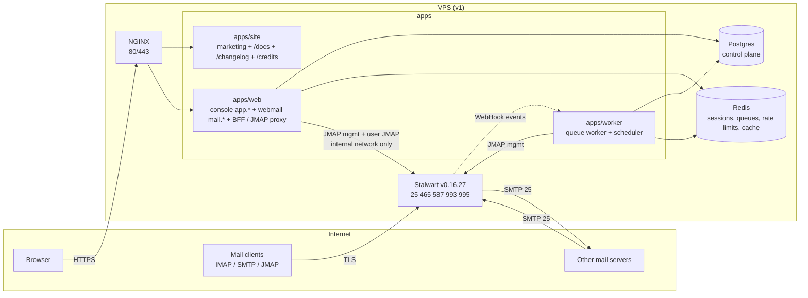

# 01 — Architecture

Last updated: 2026-10-29 (profile photos). Decisions: `adr/`. Code map: `codemap.md`.

## Overview



```
browser ──HTTPS──► NGINX ─┬─► apps/site  (anhourmail.com: marketing, /docs, /changelog, /credits)
                          └─► apps/web   (app.anhourmail.com console, mail.anhourmail.com webmail)
                                 │  BFF: our session ─► Stalwart token (server-side only)
                                 ├─► Postgres (control plane, never mail content)
                                 ├─► Redis
                                 └─► Stalwart /jmap  (internal network only; operations key: app passwords, managed Sieve)
apps/worker ─► Postgres, Redis, Stalwart management (provisioning key: provisioning jobs, DNS checks, reconciler,
               imports; the scheduler also a read-only audit key for the managed-script check — ADR-0020)
mail clients ─► Stalwart 465/587/993/995 (TLS by Stalwart itself)    MX traffic ─► Stalwart 25
```

## Components

| Component                   | Owns                                                                                                                                                                                                                                                                                               | Never does                                                                                                                      |
| --------------------------- | -------------------------------------------------------------------------------------------------------------------------------------------------------------------------------------------------------------------------------------------------------------------------------------------------- | ------------------------------------------------------------------------------------------------------------------------------- |
| `apps/site` (Next.js 16)    | Marketing pages, public docs at `/docs` (Fumadocs, ADR-0007), `/changelog`, `/credits`                                                                                                                                                                                                             | Store data or call Stalwart. "Get started" and "Sign in" link to the console (`APP_URL`); the site has no forms that post data. |
| `apps/web` (Next.js 16)     | Console (sign-up, invites, plans, billing, domains, mailboxes, aliases, audit, staff tools) and webmail UI; BFF and JMAP proxy; public API routes                                                                                                                                                  | Expose Stalwart to the browser, put mail content in Postgres or logs, or hold a Stalwart key that can create or change accounts |
| `apps/worker`               | Event-driven provisioning jobs (queue worker) and periodic jobs (scheduler: audit-chain verify, reconciler, service-account check, pending-domain re-check and expiry, mailbox purge, storage measurement); planned: transactional mail, Stalwart WebHook ingestion, imports, secret re-encryption | Run anything from a host crontab, or hold a Stalwart key that can write inside a mailbox                                        |
| `packages/core`             | Domain types, business rules, services, repository and port interfaces, audit module                                                                                                                                                                                                               | Import an ORM, driver or SDK (ADR-0008, enforced by ESLint)                                                                     |
| `packages/adapters`         | Postgres (drizzle) and in-memory implementations of every repository, plus contract tests                                                                                                                                                                                                          | Contain business rules                                                                                                          |
| `packages/stalwart-client`  | The only Stalwart management client (JMAP `x:*` objects)                                                                                                                                                                                                                                           | Touch mailbox content                                                                                                           |
| `packages/jmap-client`      | The only JMAP mail client                                                                                                                                                                                                                                                                          | Log or persist content                                                                                                          |
| `packages/shared`           | Public facts (hostnames, ports, plans, sending limits, DNS templates), RBAC matrix, shared zod schemas                                                                                                                                                                                             | Hold secrets or internal thresholds                                                                                             |
| Stalwart (unmodified, AGPL) | Mail storage, SMTP/IMAP/JMAP, spam filtering, DKIM signing, mail credentials                                                                                                                                                                                                                       | Decide tenancy or plan limits                                                                                                   |
| Postgres                    | Control-plane data                                                                                                                                                                                                                                                                                 | Mail content                                                                                                                    |
| Redis                       | Sessions, queues, rate limits, cache                                                                                                                                                                                                                                                               | Anything that can't be rebuilt, except rate-limit counters that fail closed                                                     |

## Source of truth and reconciliation

- **Postgres is the source of truth for intent:** which accounts, domains, mailboxes and aliases should exist, with which quotas and limits.
- **Customer domains:** the control plane checks DNS through the `DnsResolver` port (adapters/dns: system resolver
  in production; in development `.test` names answer as fully configured, `unverified-*` as empty). A domain turns
  `active` only when the required records pass for _its_ ownership token; then a `domain.ensure` job adds it to
  Stalwart. Removal marks it `removing` and a `domain.remove` job takes it off Stalwart (refused while accounts
  remain) before the row is deleted.
- **Stalwart is the source of truth for mail state:** messages, mail credentials, DKIM keys and their published zone (`dnsZoneFile`). The control plane caches only the DKIM public keys (`customer_domain.dkim_keys`, written by the worker's `domain.ensure`) so the console can show customers the TXT records to publish without calling Stalwart.
- **Webmail settings are split by what they control** (05-webmail.md "Settings"): display preferences per mailbox in
  Postgres (`webmail_preference`); a person's own mail flow (automatic replies, forwarding, junk lists) in one
  managed Sieve script in their Stalwart account, written by the BFF with their own token (not a provisioning job:
  it is mailbox data, like folders); sender names and signatures on their JMAP identities. Only the forwarding
  target's confirmation lives in the control plane (`forwarding_target`), and the BFF writes a redirect only to a
  confirmed target. Mail-flow changes are audited.
- Provisioning is a **job**, never an inline request (CLAUDE.md rule 26): write intent (e.g. mailbox `status = provisioning`), enqueue, the worker applies it through `stalwart-client` (idempotent upserts by natural key), then set `active` or `failed` with an error code.
- The **reconciler** (scheduler `job:reconcile`, hourly; plus the every-minute `job:service-accounts` check of the management keys' owners) compares Postgres intent with Stalwart (`x:Domain`, `x:Account` lists). It **reports** drift (audit `platform.reconciler_drift`; the alert channel comes with monitoring) and re-queues missing non-destructive state. It **never deletes** a Stalwart account or mail automatically. Deletions are explicit jobs with a grace period.

## Identity and auth model

Two identities, deliberately separate:

|             | Console identity                                                         | Mailbox identity                                                                                                                                                |
| ----------- | ------------------------------------------------------------------------ | --------------------------------------------------------------------------------------------------------------------------------------------------------------- |
| Lives in    | Postgres via better-auth                                                 | Stalwart directory                                                                                                                                              |
| Who         | A person (user) with memberships in accounts and optional platform roles | One mailbox (`name@domain`)                                                                                                                                     |
| Credentials | Email + password + optional TOTP/passkey (better-auth)                   | Mailbox password (initial, set by provisioning, hashed by Stalwart), app passwords for clients (issued by the control plane for the mailbox's person, ADR-0020) |
| Used by     | Console, webmail (via BFF)                                               | IMAP/SMTP/JMAP clients                                                                                                                                          |

We **never store mailbox passwords** (rule 23). Stalwart hashes them.

**"Add a user"** (`packages/core/src/mailboxes/add-user.ts`) creates both identities at once: a mailbox and a console
login whose sign-in email is the new address (verified, no invite), with a membership and the owner link, in one audited
transaction. The initial password (generated server-side by default, shown once) is stored only as two argon2id hashes:
the console's credential and the mailbox's pending hash for the worker. With "Require password change at first
sign-in", `user_profile.must_change_password` gates the console (only `self` permissions, every page → `/change-password`;
cleared by `afterPasswordChange`) and `mailbox.must_change_password` gates the webmail (a change-password step
before the inbox, and 403 `password_change_required` from every webmail API route but the change and sign-out; cleared
by the worker once the person's own password is applied, `07-security.md` "Mailbox passwords"). The two passwords then diverge as usual. The mailbox's
display name is sent to Stalwart as the account `description`, which seeds the sending identity's name.

**"Make this a user"** (`mailboxes/make-user.ts`) does the same for an existing unassigned mailbox (a shared address):
login, membership, profile, owner link (`mailboxes.assignOwner`, conditional on no owner) and display name in one
audited transaction, plus a new generated password queued as a `mailbox.password` job (with the management-proxy
grant) and both first-sign-in flags set. It needs a fresh step-up because it replaces a password in use. Until an
administrator's password is applied, the mailbox's own change is refused (409 `password_change_pending`) and console
reset emails to the address are held (`consoleResetHeld`); a job that gives up keeps the hash and the console asks for
it again (07-security.md "Mailbox passwords"). Profile
details stay editable afterwards (`people/profile-service.ts`): by the person (`self.profile.manage`) or the account's
admins (`member.manage` for Members, Owners for anyone).

Profile photos (ADR-0022) are one source for the console and the webmail: `packages/core/src/avatars` (the profile
edit rule for people, `mailbox.manage` for person-less mailboxes, audited) stores a 256-pixel WebP per person or
person-less mailbox in the `avatar` table, re-encoded through the `ImageNormaliser` port (sharp adapter
`packages/adapters/src/image`; magic-byte check, pixel ceiling, one frame, no metadata). The console serves them at
`/api/avatars/:kind/:id`, the webmail at `/api/webmail/avatars/:kind/:id` (same account only), both with the content
hash as the URL version, `nosniff` and a sandboxing CSP. An edit refreshes the page it was made on; the console
re-checks `/api/me/avatar` and the webmail its photos when their tab is shown again (rule 61).

Every new console or mailbox password passes a breached-password check first (core port `BreachedPasswords`, Pwned
Passwords range adapter with k-anonymity, better-auth `hooks.before` plugin for console endpoints; fail open; the web
container is the only caller and the browser never is — `07-security.md` "Breached-password check").

### Console sign-in factors (2026-10-22; `07-security.md` "Sign-in factors")

better-auth's **two-factor** plugin (TOTP + recovery codes) and **passkey** plugin (`@better-auth/passkey`, WebAuthn via
SimpleWebAuthn), plus our own plugin `packages/adapters/src/auth/security-plugin.ts` listed last so its after-hooks
see the final answers. All in `packages/adapters/src/auth` (ADR-0008); the browser never loads an auth SDK — the sign-in
form and Security page post to `/api/auth/*` directly and do the WebAuthn ceremony with `components/security/webauthn.ts`.

- Storage: `auth_two_factor` (TOTP secret = the plugin's encryption sealed again by the key ring through a wrapped
  database adapter, `sealed-adapter.ts`, AAD = user id; recovery codes as SHA-256 hashes, `recovery-codes.ts`),
  `auth_passkey` (public keys only), trusted browsers as `trust-device-*` rows in `auth_verification`.
- Sign-in: password → (2FA on, browser not trusted) a 10-minute challenge cookie → `verify-totp` or
  `verify-backup-code` → session. A passkey is a full sign-in on its own (user verification required). Our plugin
  makes codes one-time (Redis), hashes typed recovery codes, requires a current code to turn 2FA off, refuses removals
  that break an account requirement, and reports every step for the audit log (`recordSecurityEvent`, platform scope,
  target = the person).
- `/api/auth/*` is allow-listed (`server/auth/endpoints.ts`); sessions and passkey rename/remove go through core
  services (`packages/core/src/security`) so the change and its audit row share a unit of work.
- Account requirement: `customer_account.sign_in_policy`; `getActorAndSession` computes `mustEnrol` from the strictest
  policy of the person's accounts and their factors; `authorize` then refuses everything but `self` permissions
  (`enrolment_required`, 403) and console pages redirect to `/security?setup=required`.

### How the webmail gets a Stalwart session (research: `research/stalwart.md` §6)

Built in Phase 4 slice 1 (2026-10-22; ADR-0018):

1. The webmail has its own sign-in form on `mail.anhourmail.com` (mailbox address + mailbox password). The console's
   **Open webmail** link only pre-fills the address (`/sign-in?address=…`); no console cookie or handoff code reaches
   the webmail. The webmail API (`/api/webmail/*`) is served on the webmail origin only, and the console API never is
   (`server/host-routing.ts`).
2. `POST /api/webmail/auth` runs Stalwart's **headless OAuth code flow with PKCE** (`packages/stalwart-client`
   `oauth.ts`, behind `server/adapters/stalwart-oauth.ts`, client `anhourmail-webmail`): `POST /api/auth` → client
   code → `POST /auth/token`, forwarding the trusted client IP as `X-Forwarded-For` (Stalwart `x:Http.useXForwarded`). The
   password is used once and never stored or logged. Limits: `webmailSignIn` per IP and `webmailSignInAddress` (wrong
   passwords only) per address, both fail-closed; Stalwart throttling surfaces as "busy". The control plane then checks the mailbox (`MailboxAccessGate`,
   below).
3. Access and refresh tokens are **sealed with the key ring** (`packages/server/src/keyring.ts`: AES-256-GCM, HKDF per
   purpose, key id in the ciphertext, AAD = the Redis key) in Redis under `am:wm:s:<sha256(session id)>` (7 days idle,
   30 days absolute). The browser holds only the opaque id in an HttpOnly, SameSite=Lax cookie (`__Host-am.webmail` on
   https, `am.webmail` in dev). Tokens refresh a minute before expiry (one refresh per session at a time); a refused
   grant or a second 401 ends the session. Stalwart has no revocation endpoint, so sign-out drops our copy.
4. The browser calls same-origin `/api/webmail/session` (a JMAP Session document pointing at the proxy) and
   `/api/webmail/jmap`. The proxy checks the request against an allow-list (core + mail capabilities, read/list
   methods, `Email/set` for keyword updates only; ≤ 16 calls; ≤ 256 KB; `accountId` must be the session's), attaches the Bearer token, and
   forwards through a **per-user queue with ≤ 4 in flight**, retrying `limit` errors with jittered backoff. Message
   bodies come from `/api/webmail/messages/:id`, **sanitised on the server** (`server/webmail/sanitize.ts`) and shown in
   a sandboxed `srcdoc` frame. Mail the webmail sends may carry HTML: the composer and the drafts route both run it
   through the stricter outgoing allow-list (`server/webmail/outgoing-html.ts`) and send multipart/alternative with a
   text part. Attachments stream from `/api/webmail/download/:blobId` as `attachment`, `nosniff`.
   **Remote images** stay blocked in that frame; each one carries a signed image link instead of its address, and
   "Load images" posts the links to `/api/webmail/img`, the **image proxy**: the BFF (not the browser) fetches the image
   under SSRF guards (public addresses only, pinned connection, every redirect checked, size and type checks) and the
   browser shows it as a `data:` image, so the frame still loads nothing and the sender never sees the reader
   (`07-security.md` "Image proxy (SSRF)"). This is the one place the app makes outbound HTTP requests to addresses
   from mail; it needs outbound HTTP/HTTPS from the app container in production (check the ops repo's network rules).
   **The browser never sees a Stalwart token.** Webmail pages get a nonce-based CSP from `src/proxy.ts` (console pages
   get their own, stricter one there too; `07-security.md` "Standards"), which
   also sends visits to the webmail app page without a session cookie straight to sign-in (presence only; the page
   and the BFF still validate the session).
   **Contacts** never pass through the proxy (it refuses the contacts capability): dedicated `/api/webmail/contacts*`
   endpoints validate a small input and build JSContact cards in the mailbox's own Stalwart address books, and the
   send path saves new recipients to "Other contacts" (05-webmail.md "Contacts"). Contacts are mail data: nothing
   about them is stored in Postgres. Phones and desktop apps sync them over CardDAV on the client host.
5. **Suspension is enforced by the BFF too.** Stalwart refuses a suspended account's existing access tokens (403) but
   still honours its refresh grant and accepts the old token again after resume (`research/stalwart.md`). So every
   sign-in and every use of a session asks the control plane (`MailboxAccessGate` in `packages/core/src/webmail`,
   Postgres lookup by address, cached ≤ 30 s): `suspended`, `deleting` or unknown mailboxes end the session, and an
   upstream 403 does too. Mailboxes that exist only in Stalwart (dev `dev.test`) can't use the webmail.
6. Back-office jobs only (support tooling, imports) use an **impersonation service account** (`user%svc`): IP-restricted, secret in the key ring, every use audited. Never for interactive webmail.

Why the host split: the origin that renders untrusted email HTML (`mail.`) is isolated from the origin that can delete accounts and change billing (`app.`). A bug in message rendering cannot read console cookies or call console APIs (ADR-0003).

## Authorization

- One permission matrix in `packages/shared/src/rbac` (the code is canonical; `roles.md` describes it). UI, API and the RBAC harness all derive from it.
- Services check **permission + ownership scope**. Out-of-scope ids → **404**, missing permission → **403**, unauthenticated → **401**.
- Enrolment gate: a person missing a sign-in factor one of their accounts requires (`UserActor.mustEnrol`) passes only
  `self` permissions; everything else is 403 `enrolment_required` (other accounts' ids are still 404). The
  first-sign-in password gate (`UserActor.mustChangePassword`) works the same way with 403 `password_change_required`.
- Console pages get real statuses from layout guards (`apps/web/src/server/route-guard.ts`): another account's pages
  404, an account section the role lacks 403 (`forbidden.tsx`), staff pages 404 without the permission. A layout runs
  before its segment's `loading.tsx` boundary, so the status is set before streaming starts; services check again.
- What the console offers ("Add a user", "Invite someone") is decided once per request by
  `packages/core/src/people/availability.ts` (loaded through `apps/web/src/server/people-actions.ts`), so an action is
  never shown and then refused.
- Staff "act as" is Global/Support Administrator only, time-limited, banner-visible, audited, and never exposes mail content.
- People and invites (`packages/core/src/people`): an invite stores only the token hash; the route emails the link
  after the unit of work commits (a failed send is reported, never rolled back: resend). Accepting runs in one unit
  of work under the account row lock: conditional `invite.accept` (single use), then the membership, and — when
  signed out — the console login (`auth_user` + credential `auth_account`, argon2id hashed before the transaction)
  for the invited address. Role and removal guard rails: `roles.md` guard rail 9.
- Audit views (`packages/core/src/audit/{service,labels}.ts`): filtered, cursor-paged reads (area, actor kind or
  person, result, UTC dates); views carry only the network part of the IP and no user agent; staff and act-as are
  always labelled "Anhourtec staff". Staff look-up of an account (`packages/core/src/platform`) is metadata only and
  writes `staff.account_viewed` into that account's chain.
- Staff suspension (`packages/core/src/platform/suspension.ts`, Global Administrator, fresh step-up): an account's
  status becomes `suspended` and its people get 403 `account_suspended` on every account permission (`UserActor
.suspendedAccountIds`, checked in `authorize()`); a person's sign-in is refused through the same session-refusal
  path as sign-in requirements (`sessionRefusalFor`). Mailboxes are suspended through the provisioning job like any
  suspension, each with a hold (`mailbox_staff_hold`) so lifting resumes only those.

## Tenancy

The Stalwart Community edition has no tenants (Enterprise-only, `research/stalwart.md` §9). Tenancy and plan limits are enforced in our control plane (ADR-0002). We push derived limits to Stalwart: `quotas.maxDiskQuota`, object-count quotas, and outbound throttles keyed by `authenticatedAs`. `StalwartManagement.ensureTenant()` is a no-op seam for a future Enterprise licence.

## Request pipeline (apps/web)

`route(handler, { limit, session, passwordChange })` (`apps/web/src/server/http/route.ts`) wraps every API handler: request id → rate limit (tiered, per method + route pattern, fail-closed where marked) → same-origin check for unsafe methods → for `session: "webmail"` routes, the first-sign-in password gate (403 `password_change_required` unless `passwordChange: "allowed"`) → handler (resolves the actor, calls the service) → error mapping (`{ error: { code, message } }`) → access log. Handlers parse and call one service. Services enforce permission and scope and write audit entries in the same unit of work (ADR-0010).

## Health

- `GET /api/health`: liveness, touches nothing.
- `GET /api/health/ready`: Postgres (2 s), Redis (1 s) and Stalwart `/healthz/ready` (2 s). All critical; 503 if any fails.
- Payloads hold statuses and latencies only. The worker and scheduler use heartbeat-file healthchecks.

## Deploy shape

|               | v1                                                                                                                                                            | v2                                                                                  |
| ------------- | ------------------------------------------------------------------------------------------------------------------------------------------------------------- | ----------------------------------------------------------------------------------- |
| Hosts         | One VPS; provider and region are an open decision, kept in the private ops repo and never published (port 25 + rDNS criteria in `research/deliverability.md`) | Mail node(s) separate from app node                                                 |
| Mail IPs      | One dedicated mail IPv4 + IPv6 with PTR = `mx1.anhourmail.com`                                                                                                | Separate outbound IP for free accounts; second MX (`mx2`) in another data centre    |
| Stores        | Stalwart RocksDB on its own volume; Postgres 17; Redis 8                                                                                                      | Stalwart on PostgreSQL (separate cluster) or RocksDB plus S3 blobs; managed backups |
| Edge          | NGINX for 80/443 (console, webmail, site, JMAP proxy); Stalwart terminates TLS on mail ports via its own ACME                                                 | Same, behind a load balancer                                                        |
| Orchestration | Docker Compose from the **private ops repo**                                                                                                                  | Compose per node                                                                    |

**Production exposure.** Only NGINX **80/443** and Stalwart's mail ports **25, 465, 587, 993, 995** are published on public interfaces (ManageSieve 4190 and the cleartext-upgrade ports IMAP 143 / POP3 110 are not, so mail apps are only ever told about 465/587/993/995). The app, worker, Postgres, Redis and Stalwart's HTTP/JMAP/management listener are reachable only on internal Docker networks. The management API is never on a public interface; NGINX proxies only what the BFF needs, and the BFF is the only path to user JMAP.

**Platform hostnames.** The hostnames customers are told about — MX (`mx1.`), SPF include (`_spf.`), autoconfig/autodiscover, SRV targets, IMAP/SMTP/JMAP/CardDAV hosts — are built
from one setting, `PLATFORM_DOMAIN` (default `anhourmail.com`), so a staging or self-hosted install never sends its
customers to production names. Facts flow two ways from `packages/shared/src/platform.ts`:

- **Server code (configured):** `platformFacts(domain)` builds a `Platform` (hosts, `spfInclude`, client
  endpoints, CardDAV). The web app reads it per request (`apps/web/src/server/platform.ts`, validated in `env.ts`),
  the worker via `workerPlatform()` (`apps/worker/src/platform.ts`), the seed from the same variable. Core services get it as
  `deps.platform`: domain records (`customerDomainRecords(…, platform)`), live verification (`checkRecords`), the
  dev resolver's answers, reserved names (`normaliseDomain` and catch-all refuse the platform domain too). The
  console's mail-app settings, the "Free accounts use @…" line and the sign-in/webmail placeholders show it. In
  production `PLATFORM_DOMAIN` must be set explicitly and the app refuses to start unless `APP_URL` and `WEBMAIL_URL`
  are hosts directly under it (`app.<domain>`, `mail.<domain>`); worker processes (`apps/worker/src/platform.ts`) run
  the same check on `APP_URL` (`productionPlatformProblems` in `platform.ts`). Free `@…` addresses live on the
  platform domain itself (`Platform.freeAddressDomain`; ADR-0021): any account may create mailboxes there
  (`domainId: "platform"`, `packages/core/src/mailboxes/platform.ts`) — Free one, paid plans within `MAX_MAILBOXES` —
  with the shared name rules (`packages/shared/src/addresses.ts`), a confirmed console email, fail-closed limits per
  account and per client address, and no reuse across accounts (`retired_platform_address`). The domain belongs to no
  account and has no `customer_domain` row; the seed creates it on the dev Stalwart, the deployment's bootstrap in
  production (it is the system domain). `npm run db:seed` refuses a non-`.test` `PLATFORM_DOMAIN` or
  a non-local `APP_URL` (`scripts/seed/guard.ts`). System emails carry no
  hostnames of their own: their links come from `APP_URL` and their sender from `MAIL_FROM`.
- **Public site and docs (static):** `apps/site` and `docs/public` publish the product's own names through
  `PUBLIC_PLATFORM` / `HOSTS` / `CLIENT_ENDPOINTS` / `CARDDAV` / `PRODUCT_DOMAIN` (anhourmail.com), checked at build
  time by `check:docs`. They never read `PLATFORM_DOMAIN`: the public docs describe the hosted product.

ESLint (`no-restricted-syntax` in `eslint.config.mjs`) stops server code (`packages/core`, `packages/adapters`,
`apps/worker`) and `apps/web/src` from importing the published facts, so a new caller can't reintroduce production
names. There are no per-host overrides: every customer-facing host is `<label>.<PLATFORM_DOMAIN>`.

**What lives where.** This public repo ships the **images** (`deploy/Dockerfile.*`), the dev/CI `docker-compose.yml` and a self-hosting guide (`/docs/self-hosting`). Production compose files, NGINX config, server IPs, deploy secrets and tuned abuse thresholds live in a **private ops repo** and on the server, never here (rule 44).

**Dev.** `docker-compose.yml` (profiles `dev`/`ci` only) runs Postgres, Redis, Stalwart and Mailpit. Infra containers bind `DEV_BIND_ADDRESS` (default `127.0.0.1`; a maintainer may set `0.0.0.0` in their local `.env` for LAN testing). App dev servers listen on `DEV_HOST` (default `0.0.0.0`). Ports are the 43xxx scheme in CLAUDE.md: site 43100, console 43200, webmail 43300 (all on `localhost`; the webmail port is a dev forwarder into the same `apps/web`, routed by port, plus a `/webmail` fallback on 43200 in dev only), Stalwart HTTP 43080, mail ports 43025/43465/43587/43993/43190, Mailpit 43125/43026, Postgres 43432, Redis 43379. Stalwart and Mailpit sit on an internal network with no internet route (ADR-0011, `02-mail-infrastructure.md`).

## Provisioning (implemented in Phase 1)

Desired state lives in Postgres (`customer_domain`, `mailbox`, `mail_alias`); Stalwart is brought to it by jobs,
never inline in a request (CLAUDE.md rule 26).

```
console mutation ──(same transaction)──► provisioning_job (queued)
                                              │  claimNext: FOR UPDATE SKIP LOCKED; stale "running" (10 min) reclaimed
worker (apps/worker/src/worker.ts) ───────────┘
   └─ runNextJob ─► MailServer port ─► Stalwart adapter (packages/adapters/src/stalwart) ─► JMAP x:Domain / x:Account
        (domain.ensure takes the per-name lock, MailDirectoryRepository.lockDomainName, and caches the DKIM public keys)
        success → subject status active + stalwart_id; failure → retry 10/20/40/80 s; 5th failure → failed +
        audit platform.provisioning_failed
scheduler ─► job:reconcile (hourly) ─► desired vs Stalwart ─► drift report + audit platform.reconciler_drift
             (missing / unknown / quota mismatch). Never deletes.
scheduler ─► job:service-accounts (every minute) ─► management-key owners hold API keys only; drift audited as
             platform.reconciler_drift. Never removes anything.
scheduler ─► job:domain-recheck (every 5 min) ─► pending domains added in the last week whose records now pass →
             active + domain.ensure; also queues domain.ensure for domains whose DKIM keys were never read.
scheduler ─► job:audit-verify (every 6 h) ─► every audit hash chain; a break is logged at fatal (audit.md "Integrity").
scheduler ─► job:mailbox-purge (hourly) ─► deleting mailboxes past purge_after: destroy the Stalwart account, then
             the mailbox + alias rows; audit platform.mailbox_purged (system, account scope). The only path that
             deletes mail.
scheduler ─► job:domain-expiry (daily) ─► pending domains: never on Stalwart and older than 30 days → deleted; on
             Stalwart and unverified after 14 days, or ownership/MX record gone → removing + domain.remove (taken
             off Stalwart unless another row holds the name there); audit domain.expired / domain.released (system,
             account scope). A failed DNS lookup releases nothing (PENDING_DOMAIN in packages/shared).
scheduler ─► job:storage-usage (every 10 min, provisioning key) ─► batched x:Account/get (name, usedDiskQuota only)
             for every mailbox with a stalwart_id ─► mailbox.storage_used_bytes / storage_checked_at. Sizes only
             (rule 24); a failed batch keeps the last good value; not audited (an observation, not a change). The
             console reads the columns from Postgres — the web app gets no new Stalwart access (ADR-0020).
one-off   ─► job:quota-cap (deploy step: storage pooled per account) ─► per account whose quotas add up to more than
             its pool (accountPoolBytes), reads usage the same way and scales quota_bytes down in proportion, never
             below the mail held (rounded up to the next GB); queues mailbox.ensure (→ quotas.maxDiskQuota); audit
             mailbox.quota_changed (system, account scope, reason storage_pooled). Never deletes mail; re-runnable.
```

Mailbox lifecycle (status in `mailbox.status`; every change is a console mutation that queues `mailbox.ensure`):

```
provisioning ──worker──► active ──suspend──► suspended ──resume──► provisioning ──worker──► active
     any but deleting ──delete──► deleting (purge_after = now + MAILBOX_DELETE_GRACE_DAYS)
     deleting ──restore (before purge_after, domain still held)──► provisioning ──worker──► active
     deleting ──scheduler, purge_after passed──► rows gone, Stalwart account destroyed
```

- Suspended and deleting mailboxes are suspended on Stalwart with `x:Account.permissions = Merge` +
  `disabledPermissions` (sign-in on every protocol, send, receive); credentials and mail are untouched, so resume
  restores everything (`research/stalwart.md` "Suspending an account"). A deleting mailbox's aliases are also taken off
  the account (refused at `RCPT`); its address and its aliases' addresses stay reserved in Postgres until the purge.
- Lifecycle changes are conditional updates (`transition(id, from, to)`), so concurrent changes conflict (409)
  instead of overwriting each other. A running job that sees the status change underneath leaves it alone (the change
  queued its own job). Restore is refused once `purge_after` has passed, and the purge re-checks status and date
  inside its unit of work, so a restore and the purge can't both win.
- The reconciler treats active and suspended mailboxes as required, deleting mailboxes as neither missing nor
  unknown, and any mailbox Stalwart has an id for as known. It also compares suspension (active vs suspended/deleting
  against the account's disabled sign-in) and re-queues `mailbox.ensure` for each mismatch.
- A lifecycle change whose job gave up keeps its status with `last_error` set; the console shows **Not applied** (a
  boolean, never the error text) and suspending or deleting again re-queues the job (audited, `retry: true`).
  Every new lifecycle change clears `last_error`.
- One subject at a time: `claimNext` never claims a job whose subject has another non-stale job running (claims
  are serialised by a transaction advisory lock), and `apply()` re-reads the mailbox right before calling Stalwart,
  so an older job can't land after a newer one.
- The purge deletes the row (conditional on `deleting` + due, which also locks it) **before** destroying the Stalwart
  account in the same transaction: a concurrent restore waits and then gets 409; a Stalwart failure rolls back.
- Suspend / resume / delete / restore of a mailbox assigned to an Owner or admin takes an Owner (403 for a User
  Administrator, audited as denied; `roles.md` guard rail 8).

- Addresses are one namespace across `mailbox` and `mail_alias` (each table also has its own unique index). Creating
  either takes a transaction-scoped advisory lock on the address before checking it, and a unique violation maps to
  409, so concurrent creates can't share an address. Alias changes queue `mailbox.ensure`, which writes the whole
  alias list (enabled flags included) to the Stalwart account.
- Job kinds: `domain.ensure` (the domain + its catch-all address while the catch-all mailbox is active),
  `domain.remove`, `mailbox.ensure` (account + quota + suspension + aliases, including masked aliases; a new account
  gets the argon2id hash chosen at creation), `mailbox.password` (subject: a mailbox; replaces its one Password
  credential with the waiting argon2id hash — an admin's reset or the person's own change from the webmail — and
  records the credential id for the reconciler; giving up drops the person's own change but keeps an administrator's
  hash, marked by the failed job; 07-security.md "Mailbox passwords"),
  `app_password.revoke` (subject: a mailbox; destroys its `revoking` app passwords, matching id and creation time,
  then deletes the rows). Every call is idempotent (upsert by natural key), so retries and duplicate jobs are safe.
- **App passwords are the exception to "provisioning is a job"** (ADR-0020): creating one calls Stalwart inside the
  request, because the secret must go straight back to the person and nowhere else; the metadata row and the audit
  entry commit after, and a failed commit destroys the new credential again. Revocation is a job like everything else.
- Catch-all: `customer_domain.catch_all_mailbox_id`, set through `setCatchAll` (`domain.manage`, paid plans) and
  cleared in the same unit of work that suspends or deletes its mailbox (`turnOffCatchAllFor`, which re-queues the
  domain).
- New mailboxes get the argon2id hash of the password chosen at creation; one created by staff (a free platform
  address, `staffCreatePlatformMailbox`) gets a random, unusable one until the account sets a password. Mail access
  is via webmail sign-in and app passwords.
- Platform domains (free tier, staff) are desired implicitly through their mailboxes, and the configured platform
  domain always is. `RECONCILE_IGNORE_DOMAINS` lists mail-server-only infrastructure domains (dev: `dev.test`):
  unknown accounts there aren't drift — except on the platform domain, where customers' free addresses live: there
  only the system accounts (`svc-*`, `no-reply`, `postmaster`, `abuse`, `dmarc-reports`, `tls-reports`;
  `isSystemLocalPart`) are expected and anyone else is reported (ADR-0021).
- Purging a platform-domain mailbox (and deleting a masked alias there) retires its address
  (`retired_platform_address`): never reissued to another account.
- Verified by `packages/adapters/src/stalwart/provisioning.int.test.ts` against the compose stack (CI integration job).
