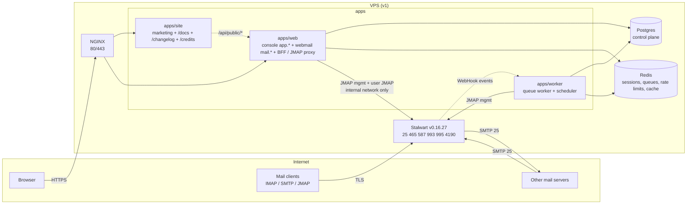

# 01 — Architecture

Last updated: 2026-10-21. Decisions: `adr/`. Code map: `codemap.md`.

## Overview



```
browser ──HTTPS──► NGINX ─┬─► apps/site  (anhourmail.com: marketing, /docs, /changelog, /credits)
                          └─► apps/web   (app.anhourmail.com console, mail.anhourmail.com webmail)
                                 │  BFF: our session ─► Stalwart token (server-side only)
                                 ├─► Postgres (control plane, never mail content)
                                 ├─► Redis
                                 └─► Stalwart /jmap  (internal network only)
apps/worker ─► Postgres, Redis, Stalwart management (provisioning jobs, DNS checks, reconciler, imports)
mail clients ─► Stalwart 465/587/993/995/4190 (TLS by Stalwart itself)    MX traffic ─► Stalwart 25
```

## Components

| Component                   | Owns                                                                                                                                                                                       | Never does                                                                                                                                                    |
| --------------------------- | ------------------------------------------------------------------------------------------------------------------------------------------------------------------------------------------ | ------------------------------------------------------------------------------------------------------------------------------------------------------------- |
| `apps/site` (Next.js 16)    | Marketing pages, waitlist form, public docs at `/docs` (Fumadocs, ADR-0007), `/changelog`, `/credits`                                                                                      | Store data or call Stalwart. The waitlist form posts same-origin to `/api/public/waitlist`, which is rewritten (dev) or routed by NGINX (prod) to `apps/web`. |
| `apps/web` (Next.js 16)     | Console (sign-up, invites, plans, billing, domains, mailboxes, aliases, audit, staff tools) and webmail UI; BFF and JMAP proxy; public API routes                                          | Expose Stalwart to the browser, or put mail content in Postgres or logs                                                                                       |
| `apps/worker`               | Event-driven jobs (provisioning, transactional mail, Stalwart WebHook ingestion, imports) and periodic jobs (DNS checks, quota sync, reconciler, audit-chain verify, secret re-encryption) | Run anything from a host crontab                                                                                                                              |
| `packages/core`             | Domain types, business rules, services, repository and port interfaces, audit module                                                                                                       | Import an ORM, driver or SDK (ADR-0008, enforced by ESLint)                                                                                                   |
| `packages/adapters`         | Postgres (drizzle) and in-memory implementations of every repository, plus contract tests                                                                                                  | Contain business rules                                                                                                                                        |
| `packages/stalwart-client`  | The only Stalwart management client (JMAP `x:*` objects)                                                                                                                                   | Touch mailbox content                                                                                                                                         |
| `packages/jmap-client`      | The only JMAP mail client                                                                                                                                                                  | Log or persist content                                                                                                                                        |
| `packages/shared`           | Public facts (hostnames, ports, plans, sending limits, DNS templates), RBAC matrix, shared zod schemas                                                                                     | Hold secrets or internal thresholds                                                                                                                           |
| Stalwart (unmodified, AGPL) | Mail storage, SMTP/IMAP/JMAP, spam filtering, DKIM signing, mail credentials                                                                                                               | Decide tenancy or plan limits                                                                                                                                 |
| Postgres                    | Control-plane data                                                                                                                                                                         | Mail content                                                                                                                                                  |
| Redis                       | Sessions, queues, rate limits, cache                                                                                                                                                       | Anything that can't be rebuilt, except rate-limit counters that fail closed                                                                                   |

## Source of truth and reconciliation

- **Postgres is the source of truth for intent:** which accounts, domains, mailboxes and aliases should exist, with which quotas and limits.
- **Stalwart is the source of truth for mail state:** messages, mail credentials, DKIM keys and their published zone (`dnsZoneFile`).
- Provisioning is a **job**, never an inline request (CLAUDE.md rule 26): write intent (`status = pending`), enqueue, the worker applies it through `stalwart-client` (idempotent upserts by natural key), then set `active` or `failed` with an error code.
- The **reconciler** (scheduler, every 15 min) compares Postgres intent with Stalwart (`x:Domain`, `x:Account` lists). It **reports** drift (audit `platform.reconciler.drift` + alert) and re-applies missing non-destructive state. It **never deletes** a Stalwart account or mail automatically. Deletions are explicit jobs with a grace period.

## Identity and auth model

Two identities, deliberately separate:

|             | Console identity                                                         | Mailbox identity                                                                                                   |
| ----------- | ------------------------------------------------------------------------ | ------------------------------------------------------------------------------------------------------------------ |
| Lives in    | Postgres via better-auth                                                 | Stalwart directory                                                                                                 |
| Who         | A person (user) with memberships in accounts and optional platform roles | One mailbox (`name@domain`)                                                                                        |
| Credentials | Email + password + optional TOTP/passkey (better-auth)                   | Mailbox password (initial, set by provisioning, hashed by Stalwart), app passwords for clients (user self-service) |
| Used by     | Console, webmail (via BFF)                                               | IMAP/SMTP/JMAP clients                                                                                             |

We **never store mailbox passwords** (rule 23). Stalwart hashes them.

### How the webmail gets a Stalwart session (research: `research/stalwart.md` §6)

1. The user signs in to the console (better-auth session cookie on `app.anhourmail.com`).
2. Opening webmail redirects to `mail.anhourmail.com/sso?code=…`: a **one-time, 60-second handoff code** (stored hashed in Redis, bound to the user and the target mailbox). The mail host exchanges it server-side and sets its own **host-only** `__Host-` session cookie. No cookie is shared on `.anhourmail.com`.
3. On first webmail use for a mailbox, the BFF runs Stalwart's **headless OAuth code flow with PKCE**: `POST /api/auth` (account + mailbox secret + MFA if set) → `clientCode` → `POST /auth/token`. The access and refresh tokens are **encrypted at rest** (secrets module, key ring, AAD = session id) and stored server-side, keyed to the webmail session.
   - Where the mailbox secret comes from at that step (prompt on first webmail open vs. derive at provisioning) is a Phase 1 prototype item (`09-roadmap.md`).
4. The browser calls `mail.anhourmail.com/jmap/*` (same origin). The BFF attaches `Authorization: Bearer <token>`, rewrites session URLs, refreshes tokens, and forwards. **The browser never sees a Stalwart token.**
5. Back-office jobs only (support tooling, imports) use an **impersonation service account** (`user%svc`): IP-restricted, secret in the key ring, every use audited. Never for interactive webmail.

Why the host split: the origin that renders untrusted email HTML (`mail.`) is isolated from the origin that can delete accounts and change billing (`app.`). A bug in message rendering cannot read console cookies or call console APIs (ADR-0003).

## Authorization

- One permission matrix in `packages/shared/src/rbac` (the code is canonical; `roles.md` describes it). UI, API and the RBAC harness all derive from it.
- Services check **permission + ownership scope**. Out-of-scope ids → **404**, missing permission → **403**, unauthenticated → **401**.
- Staff "act as" is Global/Support Administrator only, time-limited, banner-visible, audited, and never exposes mail content.

## Tenancy

The Stalwart Community edition has no tenants (Enterprise-only, `research/stalwart.md` §9). Tenancy and plan limits are enforced in our control plane (ADR-0002). We push derived limits to Stalwart: `quotas.maxDiskQuota`, object-count quotas, and outbound throttles keyed by `authenticatedAs`. `StalwartManagement.ensureTenant()` is a no-op seam for a future Enterprise licence.

## Request pipeline (apps/web)

`route(handler, { limit, auth, permission })` wraps every API handler: request id → access log → rate limit (tiered, fail-closed where marked) → same-origin check for unsafe methods → actor resolution → handler → error mapping (`{ error: { code, message } }`). Handlers parse and call one service. Services enforce permission and scope and write audit entries in the same unit of work (ADR-0010).

## Health

- `GET /api/health`: liveness, touches nothing.
- `GET /api/health/ready`: Postgres (2 s), Redis (1 s) and Stalwart `/healthz/ready` (2 s). All critical; 503 if any fails.
- Payloads hold statuses and latencies only. The worker and scheduler use heartbeat-file healthchecks.

## Deploy shape

|               | v1                                                                                                                                                            | v2                                                                                  |
| ------------- | ------------------------------------------------------------------------------------------------------------------------------------------------------------- | ----------------------------------------------------------------------------------- |
| Hosts         | One VPS; provider and region are an open decision, kept in the private ops repo and never published (port 25 + rDNS criteria in `research/deliverability.md`) | Mail node(s) separate from app node                                                 |
| Mail IPs      | One dedicated mail IPv4 + IPv6 with PTR = `mx1.anhourmail.com`                                                                                                | Separate outbound IP for free accounts; second MX (`mx2`) in another data centre    |
| Stores        | Stalwart RocksDB on its own volume; Postgres 17; Redis 8                                                                                                      | Stalwart on PostgreSQL (separate cluster) or RocksDB plus S3 blobs; managed backups |
| Edge          | NGINX for 80/443 (console, webmail, site, JMAP proxy); Stalwart terminates TLS on mail ports via its own ACME                                                 | Same, behind a load balancer                                                        |
| Orchestration | Docker Compose from the **private ops repo**                                                                                                                  | Compose per node                                                                    |

**Production exposure.** Only NGINX **80/443** and Stalwart's mail ports **25, 465, 587, 993, 995, 4190** are published on public interfaces. The app, worker, Postgres, Redis and Stalwart's HTTP/JMAP/management listener are reachable only on internal Docker networks. The management API is never on a public interface; NGINX proxies only what the BFF needs, and the BFF is the only path to user JMAP.

**What lives where.** This public repo ships the **images** (`deploy/Dockerfile.*`), the dev/CI `docker-compose.yml` and a self-hosting guide (`/docs/self-hosting`). Production compose files, NGINX config, server IPs, deploy secrets and tuned abuse thresholds live in a **private ops repo** and on the server, never here (rule 44).

**Dev.** `docker-compose.yml` (profiles `dev`/`ci` only) runs Postgres, Redis, Stalwart and Mailpit. Infra containers bind `DEV_BIND_ADDRESS` (default `127.0.0.1`; a maintainer may set `0.0.0.0` in their local `.env` for LAN testing). App dev servers listen on `DEV_HOST` (default `0.0.0.0`). Ports are the 43xxx scheme in CLAUDE.md: site 43100, console 43200, webmail 43300 (all on `localhost`; the webmail port is a dev forwarder into the same `apps/web`, routed by port, plus a `/webmail` fallback on 43200 in dev only), Stalwart HTTP 43080, mail ports 43025/43465/43587/43993/43190, Mailpit 43125/43026, Postgres 43432, Redis 43379. Stalwart and Mailpit sit on an internal network with no internet route (ADR-0011, `02-mail-infrastructure.md`).

## Provisioning (implemented in Phase 1)

Desired state lives in Postgres (`customer_domain`, `mailbox`, `mail_alias`); Stalwart is brought to it by jobs,
never inline in a request (CLAUDE.md rule 26).

```
console mutation ──(same transaction)──► provisioning_job (queued)
                                              │  claimNext: FOR UPDATE SKIP LOCKED; stale "running" (10 min) reclaimed
worker (apps/worker/src/worker.ts) ───────────┘
   └─ runNextJob ─► MailServer port ─► Stalwart adapter (packages/adapters/src/stalwart) ─► JMAP x:Domain / x:Account
        success → subject status active + stalwart_id; failure → retry 10/20/40/80 s; 5th failure → failed +
        audit platform.provisioning_failed
scheduler ─► job:reconcile (hourly) ─► desired vs Stalwart ─► drift report + audit platform.reconciler_drift
             (missing / unknown / quota mismatch). Never deletes.
```

- Job kinds: `domain.ensure`, `mailbox.ensure` (account + quota + aliases, including masked aliases). Every call
  is idempotent (upsert by natural key), so retries and duplicate jobs are safe.
- New mailboxes get a random, unusable argon2id password; mail access is via webmail sign-in and app passwords.
- Platform domains (free tier, staff) are desired implicitly through their mailboxes; `RECONCILE_IGNORE_DOMAINS`
  lists mail-server-only infrastructure domains (dev: `dev.test`).
- Verified by `packages/adapters/src/stalwart/provisioning.int.test.ts` against the compose stack (CI integration job).
